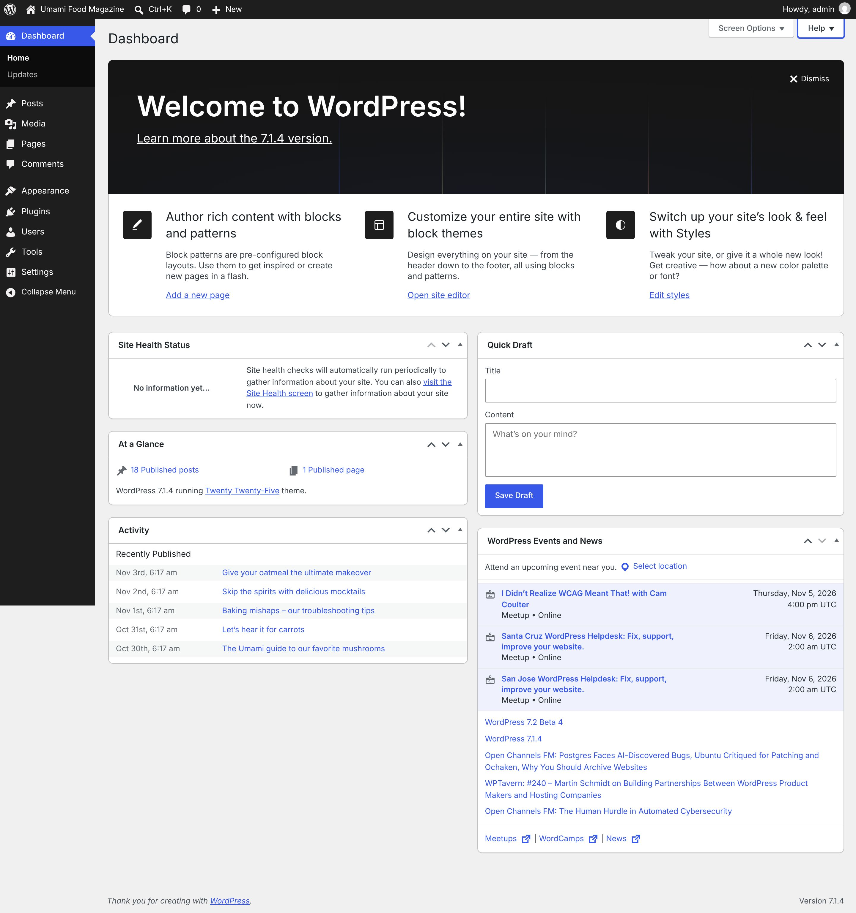
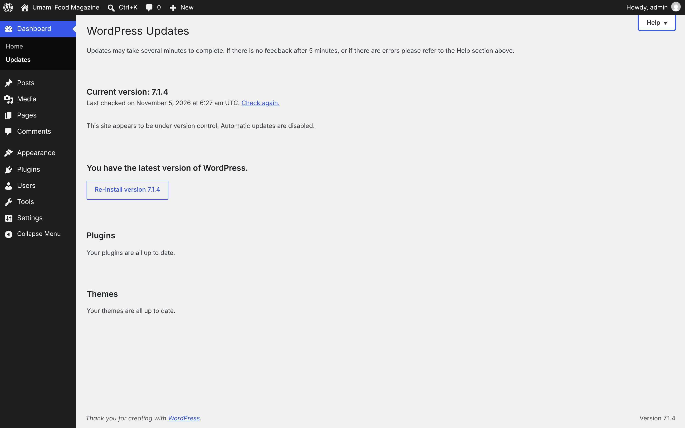
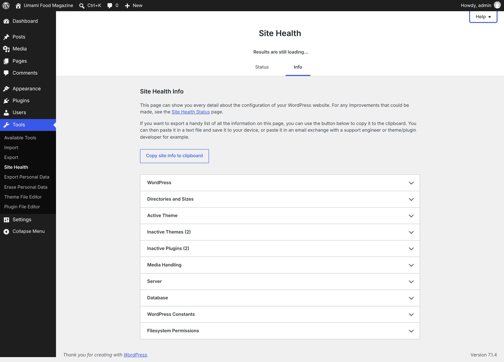

# Dashboard

[← Overview](00-overview.md)

Top-level menu **Dashboard** → `index.php`

Submenu:
- Home → `index.php`
- Updates → `update-core.php`

Pages in this file:
- [Dashboard](#dashboard)
- [Updates](#updates)
- [Site Health → Info tab](#site-health-info-tab)

---

## Dashboard

- **Menu path:** Dashboard
- **URL:** `index.php`
- **Heading:** Dashboard
- **Browser title:** Dashboard ‹ Umami Food Magazine — WordPress
- **Primary actions:** Save Draft · Submit
- **Screen Options:** Screen elements Some screen elements can be shown or hidden by using the checkboxes. Expand or collapse the elements by clicking on their headings, and arrange them by dragging their headings or by clicking on the up and down arrows. Site Health StatusAt a GlanceActivityQuick DraftWordPress Events and NewsWelcome
- **Help tabs:** Overview · Navigation · Layout · Content



<details><summary>Form fields (9)</summary>

- Site Health Status
- At a Glance
- Activity
- Quick Draft Your Recent Drafts
- WordPress Events and News
- Welcome
- Title
- Content
- City:

</details>

<details><summary>Page text</summary>

```text
Screen Options
Help
Dashboard
Dismiss
Welcome to WordPress!

Learn more about the 7.1.4 version.

Author rich content with blocks and patterns

Block patterns are pre-configured block layouts. Use them to get inspired or create new pages in a flash.

Add a new page
Customize your entire site with block themes

Design everything on your site — from the header down to the footer, all using blocks and patterns.

Open site editor
Switch up your site’s look & feel with Styles

Tweak your site, or give it a whole new look! Get creative — how about a new color palette or font?

Edit styles
Site Health Status
Move up
Move down
Show or hide panel
No information yet…

Site health checks will automatically run periodically to gather information about your site. You can also visit the Site Health screen to gather information about your site now.

At a Glance
Move up
Move down
Show or hide panel
18 Published posts
1 Published page

WordPress 7.1.4 running Twenty Twenty-Five theme.

Activity
Move up
Move down
Show or hide panel
Recently Published
Nov 3rd, 6:17 am
Give your oatmeal the ultimate makeover
Nov 2nd, 6:17 am
Skip the spirits with delicious mocktails
Nov 1st, 6:17 am
Baking mishaps – our troubleshooting tips
Oct 31st, 6:17 am
Let’s hear it for carrots
Oct 30th, 6:17 am
The Umami guide to our favorite mushrooms
Quick Draft
Move up
Move down
Show or hide panel
Title 
Content 

WordPress Events and News
Move up
Move down
Show or hide panel

Attend an upcoming event near you.  Select location

	
I Didn’t Realize WCAG Meant That! with Cam Coulter
Meetup  Online
Thursday, Nov 5, 2026
4:00 pm UTC
	
Santa Cruz WordPress Helpdesk: Fix, support, improve your website.
Meetup  Online
Friday, Nov 6, 2026
2:00 am UTC
	
San Jose WordPress Helpdesk: Fix, support, improve your website.
Meetup  Online
Friday, Nov 6, 2026
2:00 am UTC
WordPress 7.2 Beta 4
WordPress 7.1.4
Open Channels FM: Postgres Faces AI-Discovered Bugs, Ubuntu Critiqued for Patching and Ochaken, Why You Should Archive Websites
WPTavern: #240 – Martin Schmidt on Building Partnerships Between WordPress Product Makers and Hosting Companies
Open Channels FM: The Human Hurdle in Automated Cybersecurity

Meetups 
(opens in a new tab)
 | WordCamps 
(opens in a new tab)
 | News 
(opens in a new tab)
```

</details>

<details><summary>Help panel</summary>

**Overview**

Welcome to your WordPress Dashboard!
The Dashboard is the first place you will come to every time you log into your site. It is where you will find all your WordPress tools. If you need help, just click the “Help” tab above the screen title.

**Navigation**

The left-hand navigation menu provides links to all of the WordPress administration screens, with submenu items displayed on hover. You can minimize this menu to a narrow icon strip by clicking on the Collapse Menu arrow at the bottom.Links in the Toolbar at the top of the screen connect your dashboard and the front end of your site, and provide access to your profile and helpful WordPress information.

**Layout**

You can use the following controls to arrange your Dashboard screen to suit your workflow. This is true on most other administration screens as well.Screen Options — Use the Screen Options tab to choose which Dashboard boxes to show.Drag and Drop — To rearrange the boxes, drag and drop by clicking on the title bar of the selected box and releasing when you see a gray dotted-line rectangle appear in the location you want to place the box.Box Controls — Click the title bar of the box to expand or collapse it. Some boxes added by plugins may have configurable content, and will show a “Configure” link in the title bar if you hover over it.

**Content**

The boxes on your Dashboard screen are:Welcome — Shows links for some of the most common tasks when setting up a new site.Site Health Status — Informs you of any potential issues that should be addressed to improve the performance or security of your website.At a Glance — Displays a summary of the content on your site and identifies which theme and version of WordPress you are using.Activity — Shows the upcoming scheduled posts, recently published posts, and the most recent comments on your posts and allows you to moderate them.Quick Draft — Allows you to create a new post and save it as a draft. Also displays links to the 3 most recent draft posts you've started.WordPress Events and News — Upcoming events near you as well as the latest news from the official WordPress project and the WordPress Planet.

</details>

---

## Updates

- **Menu path:** Dashboard → Updates
- **URL:** `update-core.php`
- **Heading:** WordPress Updates
- **Browser title:** WordPress Updates ‹ Umami Food Magazine — WordPress
- **Primary actions:** Re-install version 7.1.4
- **Help tabs:** Overview · How to Update · Auto-updates · Restore Plugin or Theme



<details><summary>Page text</summary>

```text
Help
WordPress Updates

Updates may take several minutes to complete. If there is no feedback after 5 minutes, or if there are errors please refer to the Help section above.

Current version: 7.1.4

Last checked on November 5, 2026 at 6:27 am UTC. Check again.

This site appears to be under version control. Automatic updates are disabled.

You have the latest version of WordPress.

Plugins

Your plugins are all up to date.

Themes

Your themes are all up to date.
```

</details>

<details><summary>Help panel</summary>

**Overview**

On this screen, you can update to the latest version of WordPress, as well as update your themes, plugins, and translations.
If an update is available, you᾿ll see a notification appear in the Toolbar and navigation menu. Keeping your site updated is important for security. It also makes the internet a safer place for you and your readers.

**How to Update**

WordPress — Updating your WordPress installation is a simple one-click procedure: just click on the “Update now” button when you are notified that a new version is available. In most cases, WordPress will automatically apply maintenance and security updates in the background for you.Themes and Plugins — To update individual themes or plugins from this screen, use the checkboxes to make your selection, then click on the appropriate “Update” button. To update all of your themes or plugins at once, you can check the box at the top of the section to select all before clicking the update button.

**Auto-updates**

Auto-updates can be enabled or disabled for WordPress major versions and for each individual theme or plugin. Themes or plugins with auto-updates enabled will display the estimated date of the next auto-update. Auto-updates depends on the WP-Cron task scheduling system.Please note: Third-party themes and plugins, or custom code, may override WordPress scheduling.

**Restore Plugin or Theme**

This feature will create a temporary backup of a plugin or theme before it is upgraded. This backup is used to restore the plugin or theme back to its previous state if there is an error during the update process.On systems with fewer resources, this may lead to server timeouts or resource limits being reached. If you encounter an issue during the update process, please create a support forum topic and reference Rollback in the issue title.

</details>

---

## Site Health → Info tab

- **Menu path:** Dashboard → Site Health → Info tab
- **URL:** `site-health.php?tab=debug`
- **Heading:** Site Health
- **Browser title:** Site Health - Info ‹ Umami Food Magazine — WordPress
- **Help tabs:** Overview



<details><summary>Page text</summary>

```text
Help
Site Health
Results are still loading…
Status
Info
Site Health Info

This page can show you every detail about the configuration of your WordPress website. For any improvements that could be made, see the Site Health Status page.

If you want to export a handy list of all the information on this page, you can use the button below to copy it to the clipboard. You can then paste it in a text file and save it to your device, or paste it in an email exchange with a support engineer or theme/plugin developer for example.

Copy site info to clipboard
WordPress
Directories and Sizes
Active Theme
Inactive Themes (2)
Inactive Plugins (2)
Media Handling
Server
Database
WordPress Constants
Filesystem Permissions
```

</details>

<details><summary>Help panel</summary>

**Overview**

This screen allows you to obtain a health diagnosis of your site, and displays an overall rating of the status of your installation.
In the Status tab, you can see critical information about your WordPress configuration, along with anything else that requires your attention.
In the Info tab, you will find all the details about the configuration of your WordPress site, server, and database. There is also an export feature that allows you to copy all of the information about your site to the clipboard, to help solve problems on your site when obtaining support.

</details>
