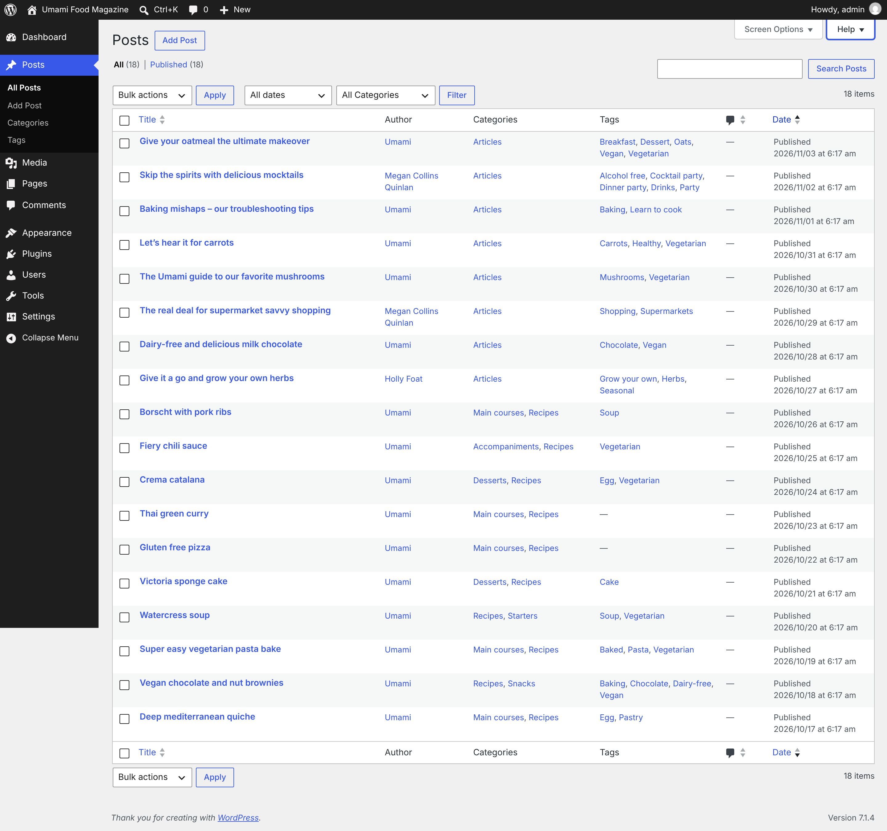
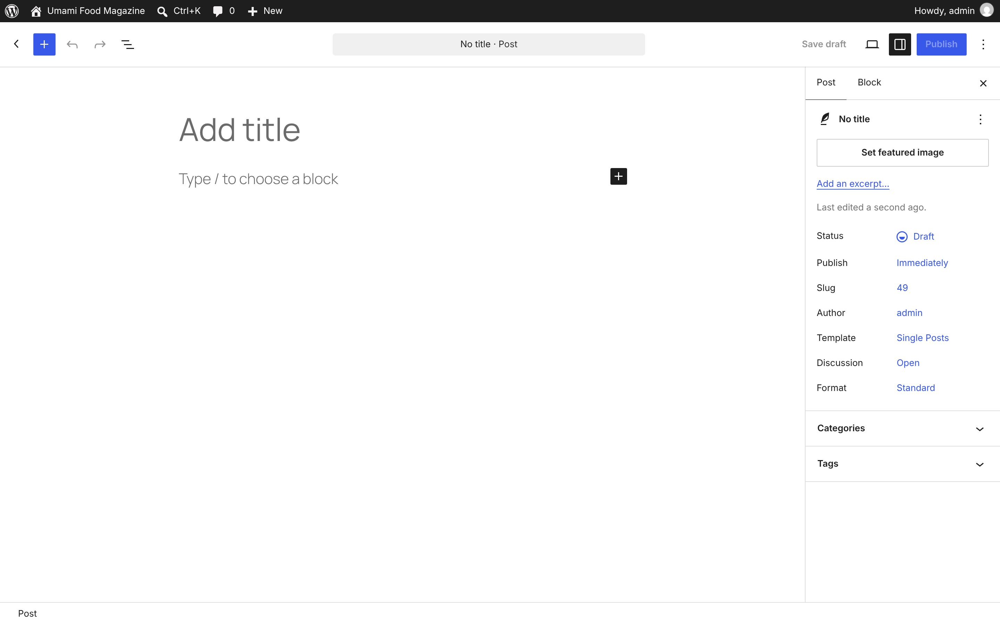
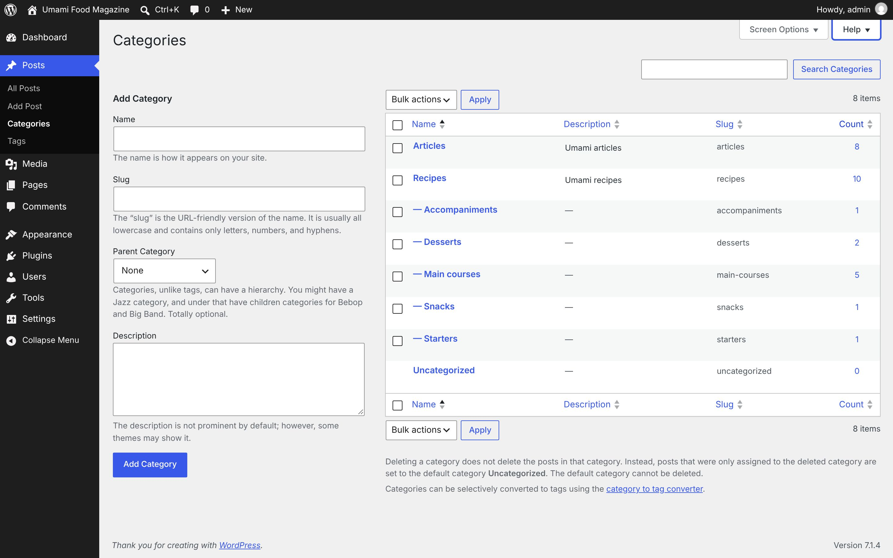
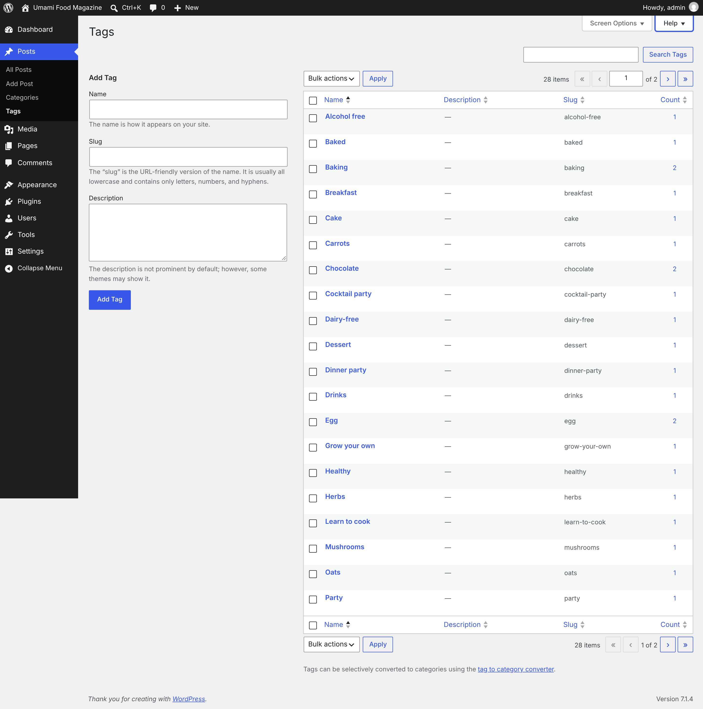
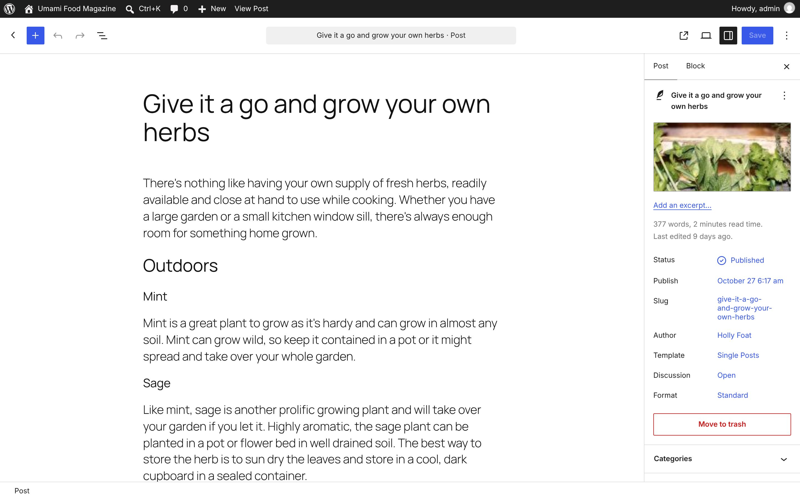

# Posts

[← Overview](00-overview.md)

Top-level menu **Posts** → `edit.php`

Submenu:
- All Posts → `edit.php`
- Add Post → `post-new.php`
- Categories → `edit-tags.php?taxonomy=category`
- Tags → `edit-tags.php?taxonomy=post_tag`

Pages in this file:
- [Posts](#posts)
- [Add Post](#add-post)
- [Categories](#categories)
- [Tags](#tags)
- [Edit Post (block editor)](#edit-post-block-editor)

---

## Posts

- **Menu path:** Posts
- **URL:** `edit.php`
- **Heading:** Posts
- **Browser title:** Posts ‹ Umami Food Magazine — WordPress
- **Tabs / filters:** All · Published
- **Primary actions:** Apply · Add Post · Search Posts · Filter · Update
- **List table columns:** Title · Author · Categories · Tags · Comments · Date
- **Screen Options:** Columns Author Categories Tags Comments Date Pagination Number of items per page: View mode Compact view Extended view
- **Help tabs:** Overview · Screen Content · Available Actions · Bulk actions



<details><summary>Form fields (56)</summary>

- Author
- Categories
- Tags
- Comments
- Date
- Number of items per page:
- Compact view
- Extended view
- Search Posts:
- Select bulk action
- Filter by date
- Filter by category
- Current Page
- Select All
- Select Give your oatmeal the ultimate makeover
- Select Skip the spirits with delicious mocktails
- Select Baking mishaps – our troubleshooting tips
- Select Let’s hear it for carrots
- Select The Umami guide to our favorite mushrooms
- Select The real deal for supermarket savvy shopping
- Select Dairy-free and delicious milk chocolate
- Select Give it a go and grow your own herbs
- Select Borscht with pork ribs
- Select Fiery chili sauce
- Select Crema catalana
- Select Thai green curry
- Select Gluten free pizza
- Select Victoria sponge cake
- Select Watercress soup
- Select Super easy vegetarian pasta bake
- Select Vegan chocolate and nut brownies
- Select Deep mediterranean quiche
- Title
- Slug
- Day
- Year
- Hour
- Minute
- Password
- Private
- Articles
- Recipes
- Accompaniments
- Desserts
- Main courses
- Snacks
- Starters
- Uncategorized
- Allow Comments
- Allow Pings
- Status Published Scheduled Pending Review Draft
- Make this post sticky
- Comments — No Change — Allow Do not allow
- Pings — No Change — Allow Do not allow
- Status — No Change — Published Private Pending Review Draft
- Sticky — No Change — Sticky Not Sticky

</details>

<details><summary>Page text</summary>

```text
Screen Options
Help
Posts Add Post
Filter posts list
All (18) | Published (18)

Search Posts:

Select bulk action
Bulk actions
Bulk edit
Move to Trash
Filter by date
All dates
November 2026
October 2026
Filter by category
All Categories
Articles
Recipes
   Accompaniments
   Desserts
   Main courses
   Snacks
   Starters
Uncategorized
18 items

Posts list
Table ordered by Date. Descending.
Select All
	
Title
Sort ascending.
	Author	Categories	Tags	
Comments
Sort ascending.
	
Date

Select Give your oatmeal the ultimate makeover
	
Give your oatmeal the ultimate makeover
Edit | Quick Edit | Trash | View
	Umami	Articles	Breakfast, Dessert, Oats, Vegan, Vegetarian	
—
No comments
	Published
2026/11/03 at 6:17 am

Select Skip the spirits with delicious mocktails
	
Skip the spirits with delicious mocktails
Edit | Quick Edit | Trash | View
	Megan Collins Quinlan	Articles	Alcohol free, Cocktail party, Dinner party, Drinks, Party	
—
No comments
	Published
2026/11/02 at 6:17 am

Select Baking mishaps – our troubleshooting tips
	
Baking mishaps – our troubleshooting tips
Edit | Quick Edit | Trash | View
	Umami	Articles	Baking, Learn to cook	
—
No comments
	Published
2026/11/01 at 6:17 am

Select Let’s hear it for carrots
	
Let’s hear it for carrots
Edit | Quick Edit | Trash | View
	Umami	Articles	Carrots, Healthy, Vegetarian	
—
No comments
	Published
2026/10/31 at 6:17 am

Select The Umami guide to our favorite mushrooms
	
The Umami guide to our favorite mushrooms
Edit | Quick Edit | Trash | View
	Umami	Articles	Mushrooms, Vegetarian	
—
No comments
	Published
2026/10/30 at 6:17 am

Select The real deal for supermarket savvy shopping
	
The real deal for supermarket savvy shopping
Edit | Quick Edit | Trash | View
	Megan Collins Quinlan	Articles	Shopping, Supermarkets	
—
No comments
	Published
2026/10/29 at 6:17 am

Select Dairy-free and delicious milk chocolate
	
Dairy-free and delicious milk chocolate
Edit | Quick Edit | Trash | View
	Umami	Articles	Chocolate, Vegan	
—
No comments
	Published
2026/10/28 at 6:17 am

Select Give it a go and grow your own herbs
	
Give it a go and grow your own herbs
Edit | Quick Edit | Trash | View
	Holly Foat	Articles	Grow your own, Herbs, Seasonal	
—
No comments
	Published
2026/10/27 at 6:17 am

Select Borscht with pork ribs
	
Borscht with pork ribs
Edit | Quick Edit | Trash | View
	Umami	Main courses, Recipes	Soup	
—
No comments
	Published
2026/10/26 at 6:17 am

Select Fiery chili sauce
	
Fiery chili sauce
Edit | Quick Edit | Trash | View
	Umami	Accompaniments, Recipes	Vegetarian	
—
No comments
	Published
2026/10/25 at 6:17 am

Select Crema catalana
	
Crema catalana
Edit | Quick Edit | Trash | View
	Umami	Desserts, Recipes	Egg, Vegetarian	
—
No comments
	Published
2026/10/24 at 6:17 am

Select Thai green curry
	
Thai green curry
Edit | Quick Edit | Trash | View
	Umami	Main courses, Recipes	—
No tags
	
—
No comments
	Published
2026/10/23 at 6:17 am

Select Gluten free pizza
	
Gluten free pizza
Edit | Quick Edit | Trash | View
	Umami	Main courses, Recipes	—
No tags
	
—
No comments
	Published
2026/10/22 at 6:17 am

Select Victoria sponge cake
	
Victoria sponge cake
Edit | Quick Edit | Trash | View
	Umami	Desserts, Recipes	Cake	
—
No comments
	Published
2026/10/21 at 6:17 am

Select Watercress soup
	
Watercress soup
Edit | Quick Edit | Trash | View
	Umami	Recipes, Starters	Soup, Vegetarian	
—
No comments
	Published
2026/10/20 at 6:17 am

Select Super easy vegetarian pasta bake
	
Super easy vegetarian pasta bake
Edit | Quick Edit | Trash | View
	Umami	Main courses, Recipes	Baked, Pasta, Vegetarian	
—
No comments
	Published
2026/10/19 at 6:17 am

Select Vegan chocolate and nut brownies
	
Vegan chocolate and nut brownies
Edit | Quick Edit | Trash | View
	Umami	Recipes, Snacks	Baking, Chocolate, Dairy-free, Vegan	
—
No comments
	Published
2026/10/18 at 6:17 am

Select Deep mediterranean quiche
	
Deep mediterranean quiche
Edit | Quick Edit | Trash | View
	Umami	Main courses, Recipes	Egg, Pastry	
—
No comments
	Publish
```

</details>

<details><summary>Help panel</summary>

**Overview**

This screen provides access to all of your posts. You can customize the display of this screen to suit your workflow.

**Screen Content**

You can customize the display of this screen’s contents in a number of ways:You can hide/display columns based on your needs and decide how many posts to list per screen using the Screen Options tab.You can filter the list of posts by post status using the text links above the posts list to only show posts with that status. The default view is to show all posts.You can view posts in a simple title list or with an excerpt using the Screen Options tab.You can refine the list to show only posts in a specific category or from a specific month by using the dropdown menus above the posts list. Click the Filter button after making your selection. You also can refine the list by clicking on the post author, category or tag in the posts list.

**Available Actions**

Hovering over a row in the posts list will display action links that allow you to manage your post. You can perform the following actions:Edit takes you to the editing screen for that post. You can also reach that screen by clicking on the post title.Quick Edit provides inline access to the metadata of your post, allowing you to update post details without leaving this screen.Trash removes your post from this list and places it in the Trash, from which you can permanently delete it.Preview will show you what your draft post will look like if you publish it. View will take you to your live site to view the post. Which link is available depends on your post’s status.

**Bulk actions**

You can also edit or move multiple posts to the Trash at once. Select the posts you want to act on using the checkboxes, then select the action you want to take from the Bulk actions menu and click Apply.When using Bulk Edit, you can change the metadata (categories, author, etc.) for all selected posts at once. To remove a post from the grouping, just click the remove button next to its name in the Bulk Edit area that appears.

</details>

---

## Add Post

- **Menu path:** Posts → Add Post
- **URL:** `post-new.php`
- **Heading:** Add Post
- **Browser title:** Add Post ‹ Umami Food Magazine — WordPress



<details><summary>Page text</summary>

```text
Add Post
No title
· Post
Save draft
Publish
Post
Block
No title
Set featured image
Add an excerpt…
Last edited a second ago.
Status
Draft
Publish
Immediately
Slug
49
Author
admin
Template
Single Posts
Discussion
Open
Format
Standard
Categories
Tags
Open publish panel
Post
```

</details>

---

## Categories

- **Menu path:** Posts → Categories
- **URL:** `edit-tags.php?taxonomy=category`
- **Heading:** Categories
- **Browser title:** Categories ‹ Umami Food Magazine — WordPress
- **Primary actions:** Apply · Search Categories · Add Category · Update Category
- **List table columns:** Name · Description · Slug · Count
- **Screen Options:** Columns Description Slug Count Pagination Number of items per page:
- **Help tabs:** Overview · Adding Categories



<details><summary>Form fields (17)</summary>

- Description
- Slug
- Count
- Number of items per page:
- Search Categories:
- Name
- Parent Category
- Select bulk action
- Current Page
- Select All
- Select Articles
- Select Recipes
- Select Accompaniments
- Select Desserts
- Select Main courses
- Select Snacks
- Select Starters

</details>

<details><summary>Page text</summary>

```text
Screen Options
Help
Categories

Search Categories:

Add Category
Name

The name is how it appears on your site.

Slug

The “slug” is the URL-friendly version of the name. It is usually all lowercase and contains only letters, numbers, and hyphens.

Parent Category
None
Articles
Recipes
   Accompaniments
   Desserts
   Main courses
   Snacks
   Starters
Uncategorized

Categories, unlike tags, can have a hierarchy. You might have a Jazz category, and under that have children categories for Bebop and Big Band. Totally optional.

Description

The description is not prominent by default; however, some themes may show it.

 

Select bulk action
Bulk actions
Delete
8 items

Categories list
Table ordered hierarchically. Ascending.
Select All
	
Name
	
Description
Sort ascending.
	
Slug
Sort ascending.
	
Count
Sort ascending.

Select Articles
	Articles

Edit | Quick Edit | Delete | View
	

Umami articles

	articles	8

Select Recipes
	Recipes

Edit | Quick Edit | Delete | View
	

Umami recipes

	recipes	10

Select Accompaniments
	— Accompaniments

Edit | Quick Edit | Delete | View
	—
No description
	accompaniments	1

Select Desserts
	— Desserts

Edit | Quick Edit | Delete | View
	—
No description
	desserts	2

Select Main courses
	— Main courses

Edit | Quick Edit | Delete | View
	—
No description
	main-courses	5

Select Snacks
	— Snacks

Edit | Quick Edit | Delete | View
	—
No description
	snacks	1

Select Starters
	— Starters

Edit | Quick Edit | Delete | View
	—
No description
	starters	1
 	Uncategorized

Edit | Quick Edit | View
	—
No description
	uncategorized	0

Select All
	
Name
	
Description
Sort ascending.
	
Slug
Sort ascending.
	
Count
Sort ascending.
Select bulk action
Bulk actions
Delete
8 items

Deleting a category does not delete the posts in that category. Instead, posts that were only assigned to the deleted category are set to the default category Uncategorized. The default category cannot be deleted.

Categories can be selectively converted to tags using the category to tag converter.
```

</details>

<details><summary>Help panel</summary>

**Overview**

You can use categories to define sections of your site and group related posts. The default category is “Uncategorized” until you change it in your writing settings.
What’s the difference between categories and tags? Normally, tags are ad-hoc keywords that identify important information in your post (names, subjects, etc) that may or may not recur in other posts, while categories are pre-determined sections. If you think of your site like a book, the categories are like the Table of Contents and the tags are like the terms in the index.

**Adding Categories**

When adding a new category on this screen, you’ll fill in the following fields:Name — The name is how it appears on your site.Slug — The “slug” is the URL-friendly version of the name. It is usually all lowercase and contains only letters, numbers, and hyphens.Parent — Categories, unlike tags, can have a hierarchy. You might have a Jazz category, and under that have child categories for Bebop and Big Band. Totally optional. To create a subcategory, just choose another category from the Parent dropdown.Description — The description is not prominent by default; however, some themes may display it.You can change the display of this screen using the Screen Options tab to set how many items are displayed per screen and to display/hide columns in the table.

</details>

---

## Tags

- **Menu path:** Posts → Tags
- **URL:** `edit-tags.php?taxonomy=post_tag`
- **Heading:** Tags
- **Browser title:** Tags ‹ Umami Food Magazine — WordPress
- **Primary actions:** Apply · Search Tags · Add Tag · Update Tag
- **List table columns:** Name · Description · Slug · Count
- **Screen Options:** Columns Description Slug Count Pagination Number of items per page:
- **Help tabs:** Overview · Adding Tags



<details><summary>Form fields (29)</summary>

- Description
- Slug
- Count
- Number of items per page:
- Search Tags:
- Name
- Select bulk action
- Current Page
- Select All
- Select Alcohol free
- Select Baked
- Select Baking
- Select Breakfast
- Select Cake
- Select Carrots
- Select Chocolate
- Select Cocktail party
- Select Dairy-free
- Select Dessert
- Select Dinner party
- Select Drinks
- Select Egg
- Select Grow your own
- Select Healthy
- Select Herbs
- Select Learn to cook
- Select Mushrooms
- Select Oats
- Select Party

</details>

<details><summary>Page text</summary>

```text
Screen Options
Help
Tags

Search Tags:

Add Tag
Name

The name is how it appears on your site.

Slug

The “slug” is the URL-friendly version of the name. It is usually all lowercase and contains only letters, numbers, and hyphens.

Description

The description is not prominent by default; however, some themes may show it.

 

Select bulk action
Bulk actions
Delete
Tags list navigation
28 items « ‹ 
Current Page
 of 2 
Next page
› 
Last page
»

Tags list
Table ordered by Name. Ascending.
Select All
	
Name
	
Description
Sort ascending.
	
Slug
Sort ascending.
	
Count
Sort ascending.

Select Alcohol free
	Alcohol free

Edit | Quick Edit | Delete | View
	—
No description
	alcohol-free	1

Select Baked
	Baked

Edit | Quick Edit | Delete | View
	—
No description
	baked	1

Select Baking
	Baking

Edit | Quick Edit | Delete | View
	—
No description
	baking	2

Select Breakfast
	Breakfast

Edit | Quick Edit | Delete | View
	—
No description
	breakfast	1

Select Cake
	Cake

Edit | Quick Edit | Delete | View
	—
No description
	cake	1

Select Carrots
	Carrots

Edit | Quick Edit | Delete | View
	—
No description
	carrots	1

Select Chocolate
	Chocolate

Edit | Quick Edit | Delete | View
	—
No description
	chocolate	2

Select Cocktail party
	Cocktail party

Edit | Quick Edit | Delete | View
	—
No description
	cocktail-party	1

Select Dairy-free
	Dairy-free

Edit | Quick Edit | Delete | View
	—
No description
	dairy-free	1

Select Dessert
	Dessert

Edit | Quick Edit | Delete | View
	—
No description
	dessert	1

Select Dinner party
	Dinner party

Edit | Quick Edit | Delete | View
	—
No description
	dinner-party	1

Select Drinks
	Drinks

Edit | Quick Edit | Delete | View
	—
No description
	drinks	1

Select Egg
	Egg

Edit | Quick Edit | Delete | View
	—
No description
	egg	2

Select Grow your own
	Grow your own

Edit | Quick Edit | Delete | View
	—
No description
	grow-your-own	1

Select Healthy
	Healthy

Edit | Quick Edit | Delete | View
	—
No description
	healthy	1

Select Herbs
	Herbs

Edit | Quick Edit | Delete | View
	—
No description
	herbs	1

Select Learn to cook
	Learn to cook

Edit | Quick Edit | Delete | View
	—
No description
	learn-to-cook	1

Select Mushrooms
	Mushrooms

Edit | Quick Edit | Delete | View
	—
No description
	mushrooms	1

Select Oats
	Oats

Edit | Quick Edit | Delete | View
	—
No description
	oats	1

Select Party
	Party

Edit | Quick Edit | Delete | View
	—
No description
	party	1

Select All
	
Name
	
Description
Sort ascending.
	
Slug
Sort ascending.
	
Count
Sort ascending.
Select bulk action
Bulk actions
Delete
28 items « ‹ 
Current Page
1 of 2 
Next page
› 
Last page
»

Tags can be selectively converted to categories using the tag to category converter.
```

</details>

<details><summary>Help panel</summary>

**Overview**

You can assign keywords to your posts using tags. Unlike categories, tags have no hierarchy, meaning there is no relationship from one tag to another.
What’s the difference between categories and tags? Normally, tags are ad-hoc keywords that identify important information in your post (names, subjects, etc) that may or may not recur in other posts, while categories are pre-determined sections. If you think of your site like a book, the categories are like the Table of Contents and the tags are like the terms in the index.

**Adding Tags**

When adding a new tag on this screen, you’ll fill in the following fields:Name — The name is how it appears on your site.Slug — The “slug” is the URL-friendly version of the name. It is usually all lowercase and contains only letters, numbers, and hyphens.Description — The description is not prominent by default; however, some themes may display it.You can change the display of this screen using the Screen Options tab to set how many items are displayed per screen and to display/hide columns in the table.

</details>

---

## Edit Post (block editor)

- **Menu path:** Posts → Edit Post (block editor)
- **URL:** `post.php?post=36&action=edit`
- **Heading:** Edit Post
- **Browser title:** Edit Post “Give it a go and grow your own herbs” ‹ Umami Food Magazine — WordPress



<details><summary>Page text</summary>

```text
Edit Post
Give it a go and grow your own herbs
· Post
Save
Post
Block
Give it a go and grow your own herbs
Replace
Remove
Add an excerpt…
377 words, 2 minutes read time.
Last edited 9 days ago.
Status
Published
Publish
October 27 6:17 am
Slug
give-it-a-go-and-grow-your-own-herbs
Author
Holly Foat
Template
Single Posts
Discussion
Open
Format
Standard
Move to trash
Categories
Tags
Open save panel
Post
```

</details>
