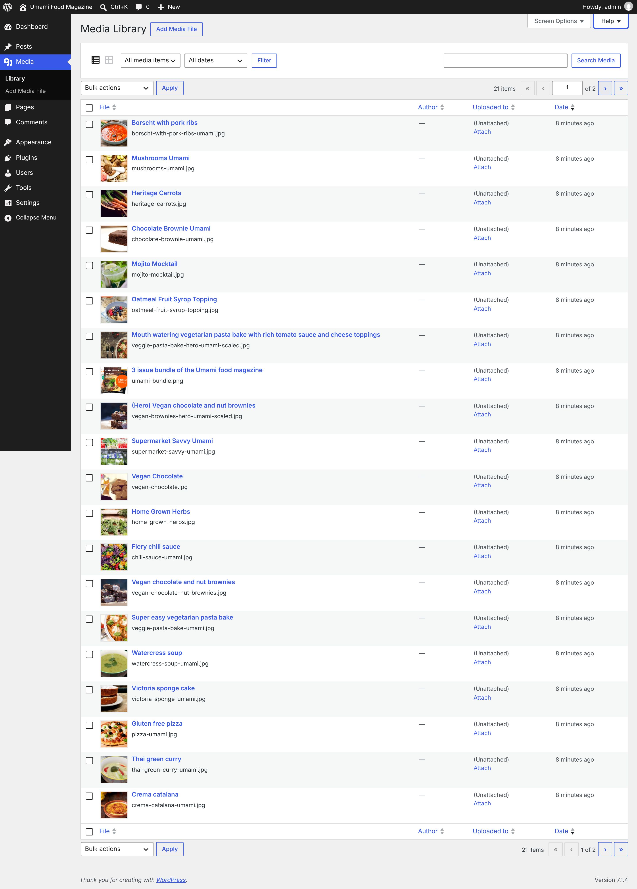
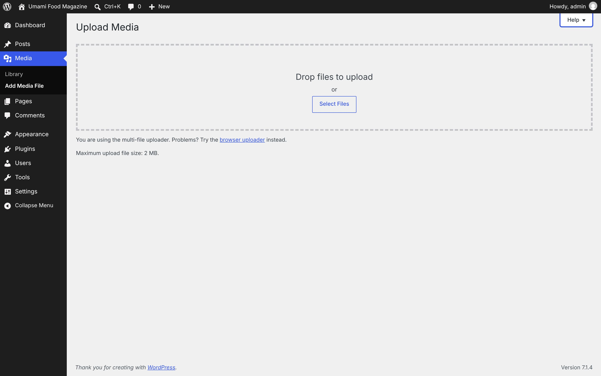

# Media

[← Overview](00-overview.md)

Top-level menu **Media** → `upload.php`

Submenu:
- Library → `upload.php`
- Add Media File → `media-new.php`

Pages in this file:
- [Media](#media)
- [Add Media File](#add-media-file)

---

## Media

- **Menu path:** Media
- **URL:** `upload.php`
- **Heading:** Media Library
- **Browser title:** Media Library ‹ Umami Food Magazine — WordPress
- **Primary actions:** Apply · Add Media File · Filter · Search Media · Select
- **List table columns:** File · Author · Uploaded to · Date
- **Screen Options:** Columns Author Uploaded to Date Pagination Number of items per page:
- **Help tabs:** Overview · Available Actions · Attaching Files



<details><summary>Form fields (30)</summary>

- Author
- Uploaded to
- Date
- Number of items per page:
- Filter by type
- Filter by date
- Search Media
- Select bulk action
- Current Page
- Select All
- Select Borscht with pork ribs
- Select Mushrooms Umami
- Select Heritage Carrots
- Select Chocolate Brownie Umami
- Select Mojito Mocktail
- Select Oatmeal Fruit Syrop Topping
- Select 3 issue bundle of the Umami food magazine
- Select (Hero) Vegan chocolate and nut brownies
- Select Supermarket Savvy Umami
- Select Vegan Chocolate
- Select Home Grown Herbs
- Select Fiery chili sauce
- Select Vegan chocolate and nut brownies
- Select Super easy vegetarian pasta bake
- Select Watercress soup
- Select Victoria sponge cake
- Select Gluten free pizza
- Select Thai green curry
- Select Crema catalana
- Search

</details>

<details><summary>Page text</summary>

```text
Screen Options
Help
Media Library Add Media File
Filter media items list
List view
Grid view
 
Filter by type
All media items
Images
Unattached
Mine
 
Filter by date
All dates
November 2026
 

Search Media

Select bulk action
Bulk actions
Delete permanently
Media items list navigation
21 items « ‹ 
Current Page
 of 2 
Next page
› 
Last page
»

Media items list
Table ordered by Date. Descending.
Select All
	
File
Sort ascending.
	
Author
Sort ascending.
	
Uploaded to
Sort ascending.
	
Date

Select Borscht with pork ribs
	
Borscht with pork ribs

File name:
borscht-with-pork-ribs-umami.jpg

Edit | Delete Permanently | View | Copy URL | Download file
	—
(no author)
	(Unattached)
Attach	8 minutes ago

Select Mushrooms Umami
	
Mushrooms Umami

File name:
mushrooms-umami.jpg

Edit | Delete Permanently | View | Copy URL | Download file
	—
(no author)
	(Unattached)
Attach	8 minutes ago

Select Heritage Carrots
	
Heritage Carrots

File name:
heritage-carrots.jpg

Edit | Delete Permanently | View | Copy URL | Download file
	—
(no author)
	(Unattached)
Attach	8 minutes ago

Select Chocolate Brownie Umami
	
Chocolate Brownie Umami

File name:
chocolate-brownie-umami.jpg

Edit | Delete Permanently | View | Copy URL | Download file
	—
(no author)
	(Unattached)
Attach	8 minutes ago

Select Mojito Mocktail
	
Mojito Mocktail

File name:
mojito-mocktail.jpg

Edit | Delete Permanently | View | Copy URL | Download file
	—
(no author)
	(Unattached)
Attach	8 minutes ago

Select Oatmeal Fruit Syrop Topping
	
Oatmeal Fruit Syrop Topping

File name:
oatmeal-fruit-syrup-topping.jpg

Edit | Delete Permanently | View | Copy URL | Download file
	—
(no author)
	(Unattached)
Attach	8 minutes ago

Select Mouth watering vegetarian pasta bake with rich tomato sauce and cheese toppings
	
Mouth watering vegetarian pasta bake with rich tomato sauce and cheese toppings

File name:
veggie-pasta-bake-hero-umami-scaled.jpg

Edit | Delete Permanently | View | Copy URL | Download file
	—
(no author)
	(Unattached)
Attach	8 minutes ago

Select 3 issue bundle of the Umami food magazine
	
3 issue bundle of the Umami food magazine

File name:
umami-bundle.png

Edit | Delete Permanently | View | Copy URL | Download file
	—
(no author)
	(Unattached)
Attach	8 minutes ago

Select (Hero) Vegan chocolate and nut brownies
	
(Hero) Vegan chocolate and nut brownies

File name:
vegan-brownies-hero-umami-scaled.jpg

Edit | Delete Permanently | View | Copy URL | Download file
	—
(no author)
	(Unattached)
Attach	8 minutes ago

Select Supermarket Savvy Umami
	
Supermarket Savvy Umami

File name:
supermarket-savvy-umami.jpg

Edit | Delete Permanently | View | Copy URL | Download file
	—
(no author)
	(Unattached)
Attach	8 minutes ago

Select Vegan Chocolate
	
Vegan Chocolate

File name:
vegan-chocolate.jpg

Edit | Delete Permanently | View | Copy URL | Download file
	—
(no author)
	(Unattached)
Attach	8 minutes ago

Select Home Grown Herbs
	
Home Grown Herbs

File name:
home-grown-herbs.jpg

Edit | Delete Permanently | View | Copy URL | Download file
	—
(no author)
	(Unattached)
Attach	8 minutes ago

Select Fiery chili sauce
	
Fiery chili sauce

File name:
chili-sauce-umami.jpg

Edit | Delete Permanently | View | Copy URL | Download file
	—
(no author)
	(Unattached)
Attach	8 minutes ago

Select Vegan chocolate and nut brownies
	
Vegan chocolate and nut brownies

File name:
vegan-chocolate-nut-brownies.jpg

Edit | Delete Permanently | View | Copy URL | Download file
	—
(no author)
	(Unattached)
Attach	8 minutes ago

Select Super easy vegetarian pasta bake
	
Super easy vegetarian pasta bake

File name:
veggie-pasta-bake-umami.jpg

Edit | Delete Permanently | View | Copy URL | Download file
	—
(no author)
	(Unattached)
Attach	8 minutes ago

Select Watercress soup
	
Watercress soup

File name:
watercress-soup-umami.jpg

Edit | Delete Permanently | View | Copy URL | Download file
	—
(no author)
	(Unattached)
Attach	8 minutes ago

Select Victoria sponge cake
	
Victoria sponge cake

File name:
vi
```

</details>

<details><summary>Help panel</summary>

**Overview**

All the files you’ve uploaded are listed in the Media Library, with the most recent uploads listed first. You can use the Screen Options tab to customize the display of this screen.
You can narrow the list by file type/status or by date using the dropdown menus above the media table.
You can view your media in a simple visual grid or a list with columns. Switch between these views using the icons to the left above the media.

**Available Actions**

Hovering over a row reveals action links that allow you to manage media items. You can perform the following actions:Edit takes you to a simple screen to edit that individual file’s metadata. You can also reach that screen by clicking on the media file name or thumbnail.Delete Permanently will delete the file from the media library (as well as from any posts to which it is currently attached).View will take you to a public display page for that file.Copy URL copies the URL for the media file to your clipboard.Download file downloads the original media file to your device.

**Attaching Files**

If a media file has not been attached to any content, you will see that in the Uploaded To column, and can click on Attach to launch a small popup that will allow you to search for existing content and attach the file.

</details>

---

## Add Media File

- **Menu path:** Media → Add Media File
- **URL:** `media-new.php`
- **Heading:** Upload Media
- **Browser title:** Upload Media ‹ Umami Food Magazine — WordPress
- **Primary actions:** Upload
- **Help tabs:** Overview



<details><summary>Form fields (1)</summary>

- Upload

</details>

<details><summary>Page text</summary>

```text
Help
Upload Media

Drop files to upload

or

You are using the multi-file uploader. Problems? Try the browser uploader instead.

Maximum upload file size: 2 MB.
```

</details>

<details><summary>Help panel</summary>

**Overview**

You can upload media files here without creating a post first. This allows you to upload files to use with posts and pages later and/or to get a web link for a particular file that you can share. There are three options for uploading files:
Drag and drop your files into the area below. Multiple files are allowed.
Clicking Select Files opens a navigation window showing you files in your operating system. Selecting Open after clicking on the file you want activates a progress bar on the uploader screen.
Revert to the Browser Uploader by clicking the link below the drag and drop box.

</details>
