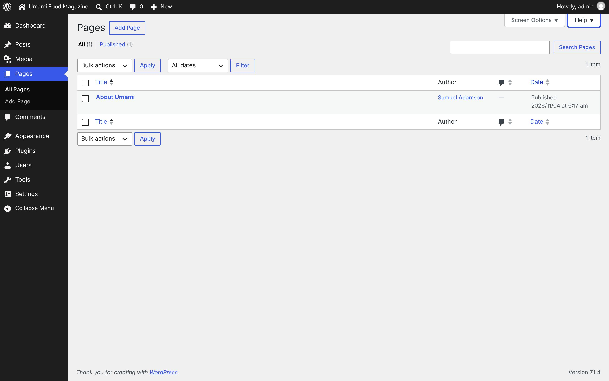
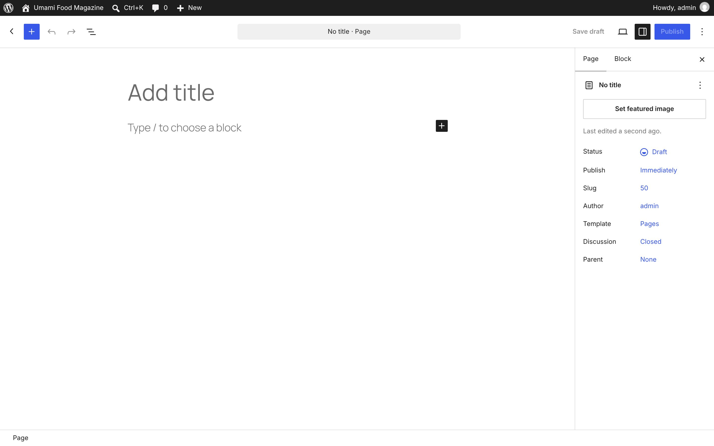
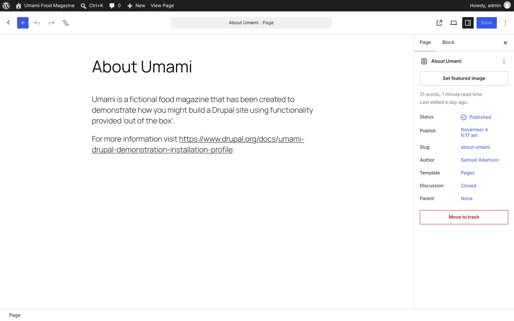

# Pages

[← Overview](00-overview.md)

Top-level menu **Pages** → `edit.php?post_type=page`

Submenu:
- All Pages → `edit.php?post_type=page`
- Add Page → `post-new.php?post_type=page`

Pages in this file:
- [Pages](#pages)
- [Add Page](#add-page)
- [Edit Page (block editor)](#edit-page-block-editor)

---

## Pages

- **Menu path:** Pages
- **URL:** `edit.php?post_type=page`
- **Heading:** Pages
- **Browser title:** Pages ‹ Umami Food Magazine — WordPress
- **Tabs / filters:** All · Published
- **Primary actions:** Apply · Add Page · Search Pages · Filter · Update
- **List table columns:** Title · Author · Comments · Date
- **Screen Options:** Columns Author Comments Date Pagination Number of items per page: View mode Compact view Extended view
- **Help tabs:** Overview · Managing Pages



<details><summary>Form fields (29)</summary>

- Author
- Comments
- Date
- Number of items per page:
- Compact view
- Extended view
- Search Pages:
- Select bulk action
- Filter by date
- Current Page
- Select All
- Select About Umami
- Title
- Slug
- Day
- Year
- Hour
- Minute
- Password
- Private
- Parent Main Page (no parent) About Umami
- Order
- Template Default template Page No Title
- Allow Comments
- Status Published Scheduled Pending Review Draft
- Parent — No Change — Main Page (no parent) About Umami
- Template — No Change — Default template Page No Title
- Comments — No Change — Allow Do not allow
- Status — No Change — Published Private Pending Review Draft

</details>

<details><summary>Page text</summary>

```text
Screen Options
Help
Pages Add Page
Filter pages list
All (1) | Published (1)

Search Pages:

Select bulk action
Bulk actions
Bulk edit
Move to Trash
Filter by date
All dates
November 2026
1 item

Pages list
Table ordered by Hierarchical Menu Order and Title. Ascending.
Select All
	
Title
	Author	
Comments
Sort ascending.
	
Date
Sort descending.

Select About Umami
	
About Umami
Edit | Quick Edit | Trash | View
	Samuel Adamson	
—
No comments
	Published
2026/11/04 at 6:17 am

Select All
	
Title
	Author	
Comments
Sort ascending.
	
Date
Sort descending.
Select bulk action
Bulk actions
Bulk edit
Move to Trash
1 item
```

</details>

<details><summary>Help panel</summary>

**Overview**

Pages are similar to posts in that they have a title, body text, and associated metadata, but they are different in that they are not part of the chronological blog stream, kind of like permanent posts. Pages are not categorized or tagged, but can have a hierarchy. You can nest pages under other pages by making one the “Parent” of the other, creating a group of pages.

**Managing Pages**

Managing pages is very similar to managing posts, and the screens can be customized in the same way.You can also perform the same types of actions, including narrowing the list by using the filters, acting on a page using the action links that appear when you hover over a row, or using the Bulk actions menu to edit the metadata for multiple pages at once.

</details>

---

## Add Page

- **Menu path:** Pages → Add Page
- **URL:** `post-new.php?post_type=page`
- **Heading:** Add Page
- **Browser title:** Add Page ‹ Umami Food Magazine — WordPress



<details><summary>Page text</summary>

```text
Add Page
No title
· Page
Save draft
Publish
Page
Block
No title
Set featured image
Last edited a second ago.
Status
Draft
Publish
Immediately
Slug
50
Author
admin
Template
Pages
Discussion
Closed
Parent
None
Open publish panel
Page
```

</details>

---

## Edit Page (block editor)

- **Menu path:** Pages → Edit Page (block editor)
- **URL:** `post.php?post=44&action=edit`
- **Heading:** Edit Page
- **Browser title:** Edit Page “About Umami” ‹ Umami Food Magazine — WordPress



<details><summary>Page text</summary>

```text
Edit Page
About Umami
· Page
Save
Page
Block
About Umami
Set featured image
31 words, 1 minute read time.
Last edited a day ago.
Status
Published
Publish
November 4 6:17 am
Slug
about-umami
Author
Samuel Adamson
Template
Pages
Discussion
Closed
Parent
None
Move to trash
Open save panel
Page
```

</details>
