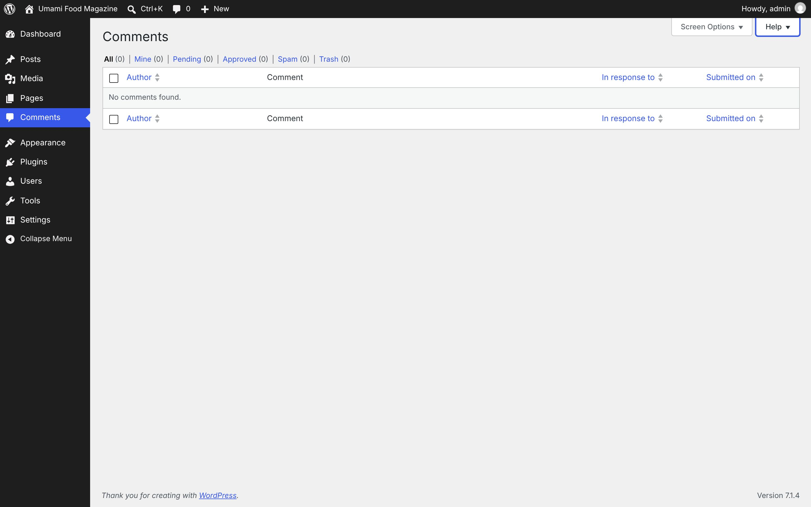

# Comments

[← Overview](00-overview.md)

Top-level menu **Comments** → `edit-comments.php`

Submenu:
- (no submenu)

Pages in this file:
- [Comments](#comments)

---

## Comments

- **Menu path:** Comments
- **URL:** `edit-comments.php`
- **Heading:** Comments
- **Browser title:** Comments ‹ Umami Food Magazine — WordPress
- **Tabs / filters:** All · Mine · Pending · Approved · Spam · Trash
- **Primary actions:** Apply · Add Comment
				Update Comment
				Submit Reply
- **List table columns:** Author · Comment · In response to · Submitted on
- **Screen Options:** Columns Author In response to Submitted on Pagination Number of items per page: View mode Compact view Extended view
- **Help tabs:** Overview · Moderating Comments



<details><summary>Form fields (11)</summary>

- Author
- In response to
- Submitted on
- Number of items per page:
- Compact view
- Extended view
- Select All
- Comment
- Name
- Email
- URL

</details>

<details><summary>Page text</summary>

```text
Screen Options
Help
Comments
Filter comments list
All (0) | Mine (0) | Pending (0) | Approved (0) | Spam (0) | Trash (0)
Comments list
Ordered by Comment Date, descending.
Select All
	
Author
Sort ascending.
	Comment	
In response to
Sort ascending.
	
Submitted on
Sort ascending.

No comments found.

Select All
	
Author
Sort ascending.
	Comment	
In response to
Sort ascending.
	
Submitted on
Sort ascending.
```

</details>

<details><summary>Help panel</summary>

**Overview**

You can manage comments made on your site similar to the way you manage posts and other content. This screen is customizable in the same ways as other management screens, and you can act on comments using the on-hover action links or the bulk actions.

**Moderating Comments**

A red bar on the left means the comment is waiting for you to moderate it.In the Author column, in addition to the author’s name, email address, and site URL, the commenter’s IP address is shown. Clicking on this link will show you all the comments made from this IP address.In the Comment column, hovering over any comment gives you options to approve, reply (and approve), quick edit, edit, spam mark, or trash that comment.In the In response to column, there are three elements. The text is the name of the post that inspired the comment, and links to the post editor for that entry. The View Post link leads to that post on your live site. The small bubble with the number in it shows the number of approved comments that post has received. If there are pending comments, a red notification circle with the number of pending comments is displayed. Clicking the notification circle will filter the comments screen to show only pending comments on that post.In the Submitted on column, the date and time the comment was left on your site appears. Clicking on the date/time link will take you to that comment on your live site.Many people take advantage of keyboard shortcuts to moderate their comments more quickly. Use the link to the side to learn more.

</details>
