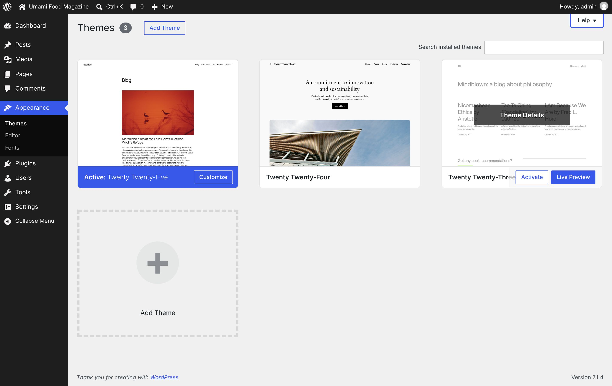
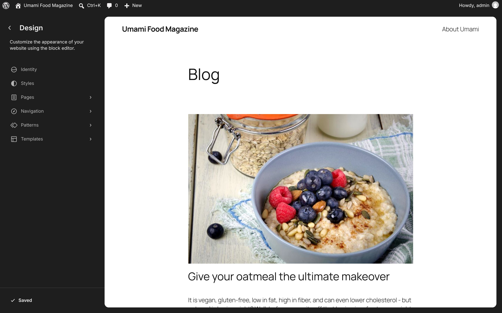
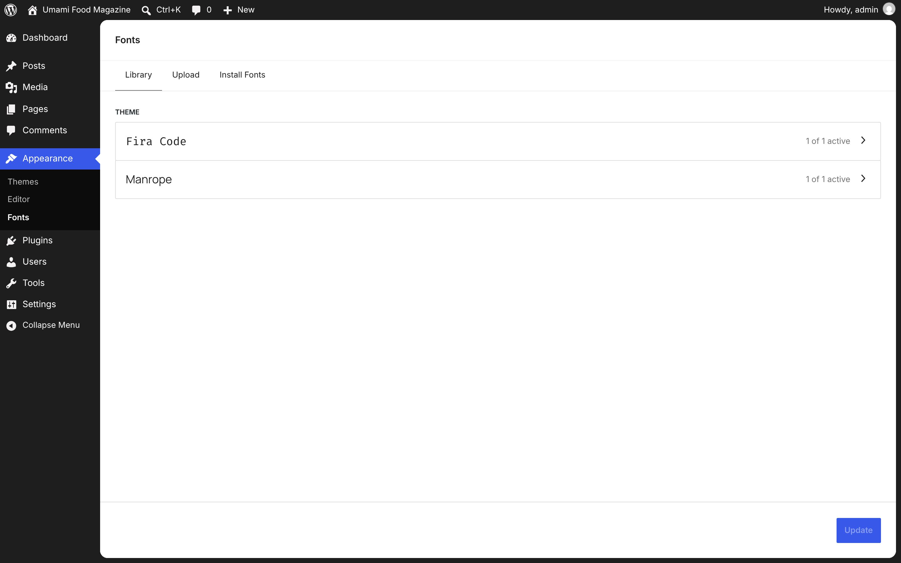
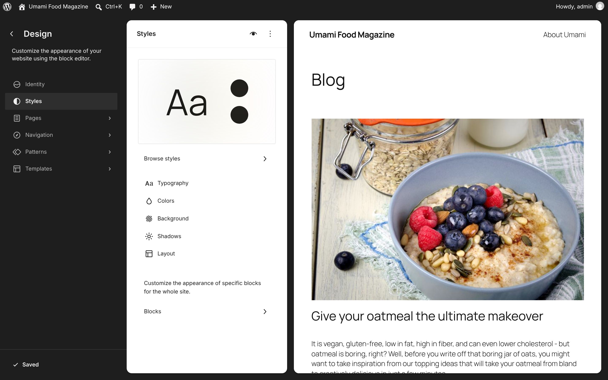
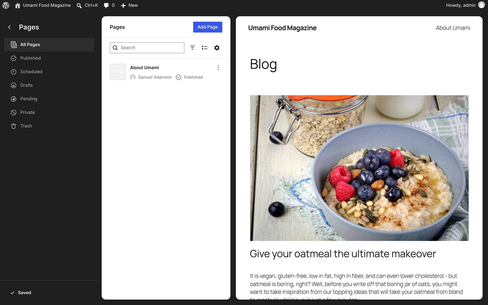
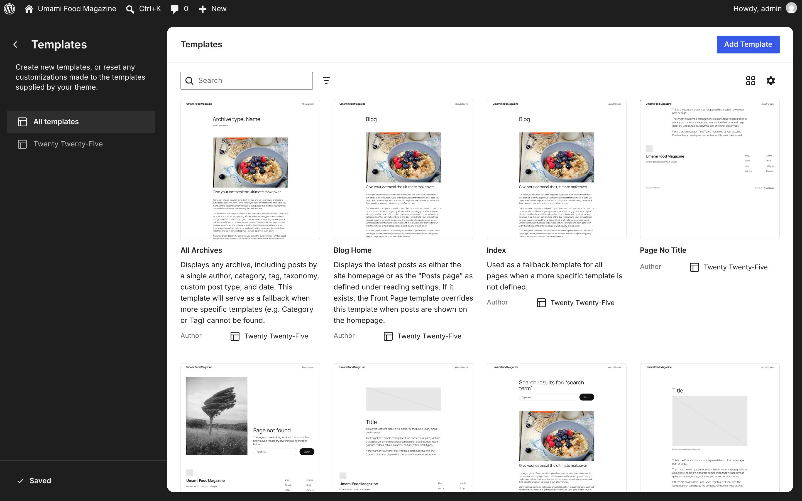
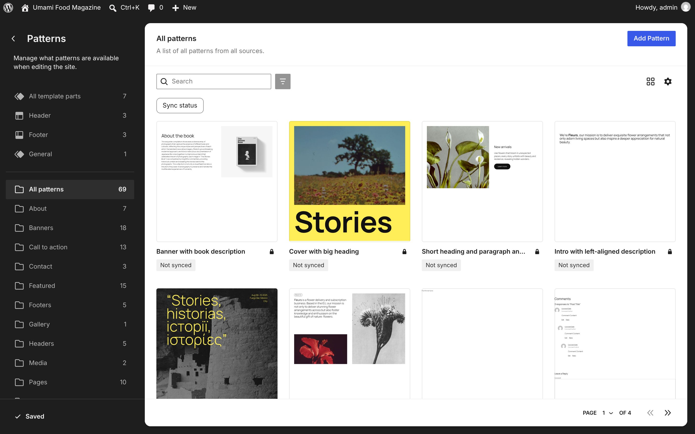
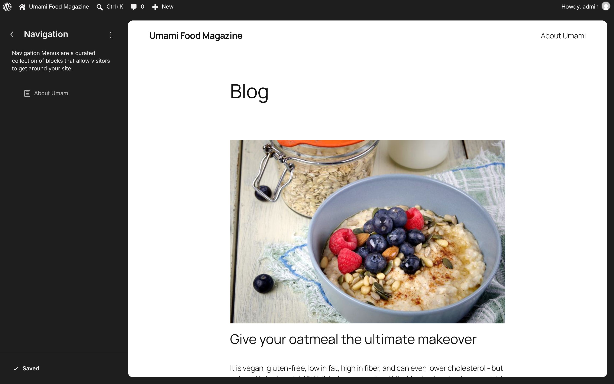
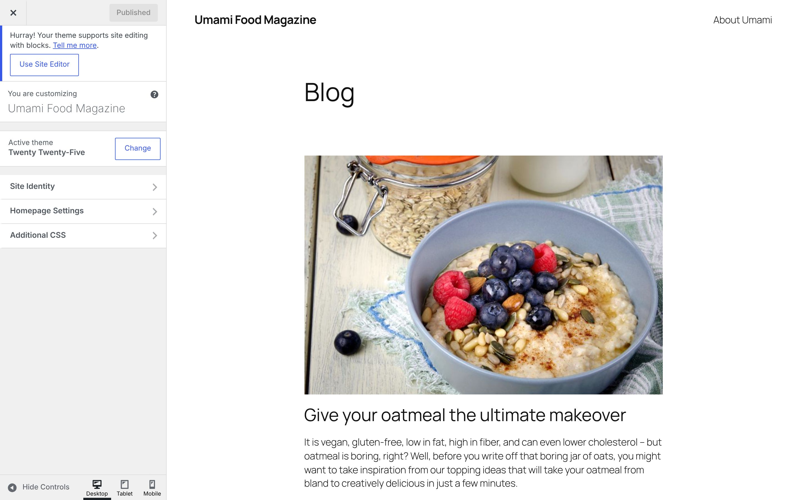

# Appearance

[← Overview](00-overview.md)

Top-level menu **Appearance** → `themes.php`

Submenu:
- Themes → `themes.php`
- Editor → `site-editor.php`
- Fonts → `font-library.php`

Pages in this file:
- [Appearance](#appearance)
- [Editor](#editor)
- [Fonts](#fonts)
- [Site Editor → Styles](#site-editor-styles)
- [Site Editor → Pages](#site-editor-pages)
- [Site Editor → Templates](#site-editor-templates)
- [Site Editor → Patterns](#site-editor-patterns)
- [Site Editor → Navigation](#site-editor-navigation)
- [Customize (classic customizer)](#customize-classic-customizer)

---

## Appearance

- **Menu path:** Appearance
- **URL:** `themes.php`
- **Heading:** Themes 3
- **Browser title:** Themes ‹ Umami Food Magazine — WordPress
- **Primary actions:** Add Theme
- **Help tabs:** Overview · Adding Themes · Previewing and Customizing · Auto-updates



<details><summary>Form fields (1)</summary>

- Search installed themes

</details>

<details><summary>Page text</summary>

```text
Help
Themes 3 Add Theme

Search installed themes

Theme Details
Active: Twenty Twenty-Five
Customize
Theme Details
Twenty Twenty-Four
Activate Live Preview
Theme Details
Twenty Twenty-Three
Activate Live Preview
Add Theme
```

</details>

<details><summary>Help panel</summary>

**Overview**

This screen is used for managing your installed themes. Aside from the default theme(s) included with your WordPress installation, themes are designed and developed by third parties.
From this screen you can:
Hover or tap to see Activate and Live Preview buttons.
Click Customize for the active theme or Live Preview for any other theme to see a live preview.
Click on a theme to open the Theme Details dialog and see the theme name, version, author, description, tags, and the Delete link.
Use the buttons at the top of the dialog, or alt/option plus the left or right arrow keys on your keyboard, to navigate between themes quickly.
The active theme is displayed highlighted as the first theme.
The search for installed themes will search for terms in their name, description, author, or tag. The search results will be updated as you type.

**Adding Themes**

If you would like to see more themes to choose from, click on the “Add Theme” button and you will be able to browse or search for additional themes from the WordPress Theme Directory. Themes in the WordPress Theme Directory are designed and developed by third parties, and are compatible with the license WordPress uses. Oh, and they are free!

**Previewing and Customizing**

Tap or hover on any theme then click the Live Preview button to see a live preview of that theme and change theme options in a separate, full-screen view. You can also find a Live Preview button at the bottom of the theme details screen. Any installed theme can be previewed and customized in this way.The theme being previewed is fully interactive — navigate to different pages to see how the theme handles posts, archives, and other page templates. The settings may differ depending on what theme features the theme being previewed supports. To accept the new settings and activate the theme all in one step, click the Activate & Publish button above the menu.When previewing on smaller monitors, you can use the collapse icon at the bottom of the left-hand pane. This will hide the pane, giving you more room to preview your site in the new theme. To bring the pane back, click on the collapse icon again.

**Auto-updates**

Auto-updates can be enabled or disabled for each individual theme. Themes with auto-updates enabled will display the estimated date of the next auto-update. Auto-updates depends on the WP-Cron task scheduling system.Please note: Third-party themes and plugins, or custom code, may override WordPress scheduling.

</details>

---

## Editor

- **Menu path:** Appearance → Editor
- **URL:** `site-editor.php`
- **Heading:** Design
- **Browser title:** Blog Home ‹ Template ‹ Umami Food Magazine ‹ Editor — WordPress



<details><summary>Page text</summary>

```text
Design
Customize the appearance of your website using the block editor.
Identity
Styles
Pages
Navigation
Patterns
Templates
Saved
```

</details>

---

## Fonts

- **Menu path:** Appearance → Fonts
- **URL:** `font-library.php` (redirects to `font-library.php?p=%2Ffont-list`)
- **Heading:** Fonts
- **Browser title:** Fonts ‹ Umami Food Magazine — WordPress



<details><summary>Page text</summary>

```text
Fonts
Library
Upload
Install Fonts
THEME
Fira Code
1 of 1 active
Manrope
1 of 1 active
Update
```

</details>

---

## Site Editor → Styles

- **Menu path:** Appearance → Site Editor → Styles
- **URL:** `site-editor.php?p=%2Fstyles`
- **Heading:** Design
- **Browser title:** Blog Home ‹ Template ‹ Umami Food Magazine ‹ Editor — WordPress



<details><summary>Page text</summary>

```text
Design
Customize the appearance of your website using the block editor.
Identity
Styles
Pages
Navigation
Patterns
Templates
Saved
Styles
Aa
Browse styles
Typography
Colors
Background
Shadows
Layout

Customize the appearance of specific blocks for the whole site.

Blocks
```

</details>

---

## Site Editor → Pages

- **Menu path:** Appearance → Site Editor → Pages
- **URL:** `site-editor.php?p=%2Fpage`
- **Heading:** Pages
- **Browser title:** Blog Home ‹ Template ‹ Umami Food Magazine ‹ Editor — WordPress



<details><summary>Page text</summary>

```text
Pages
All Pages
Published
Scheduled
Drafts
Pending
Private
Trash
Saved
Pages
Add Page
Search
About Umami
Edit
Author
Samuel Adamson
Status
Published
```

</details>

---

## Site Editor → Templates

- **Menu path:** Appearance → Site Editor → Templates
- **URL:** `site-editor.php?p=%2Ftemplate`
- **Heading:** Templates
- **Browser title:** Editor ‹ Umami Food Magazine — WordPress



<details><summary>Page text</summary>

```text
Templates
Create new templates, or reset any customizations made to the templates supplied by your theme.
All templates
Twenty Twenty-Five
Saved
Templates
Add Template
Search
All Archives
Displays any archive, including posts by a single author, category, tag, taxonomy, custom post type, and date. This template will serve as a fallback when more specific templates (e.g. Category or Tag) cannot be found.
Author
Twenty Twenty-Five
Blog Home
Displays the latest posts as either the site homepage or as the "Posts page" as defined under reading settings. If it exists, the Front Page template overrides this template when posts are shown on the homepage.
Author
Twenty Twenty-Five
Index
Used as a fallback template for all pages when a more specific template is not defined.
Author
Twenty Twenty-Five
Page No Title
Author
Twenty Twenty-Five
Page: 404
Displays when a visitor views a non-existent page, such as a dead link or a mistyped URL.
Author
Twenty Twenty-Five
Pages
Displays a static page unless a custom template has been applied to that page or a dedicated template exists.
Author
Twenty Twenty-Five
Search Results
Displays when a visitor performs a search on your website.
Author
Twenty Twenty-Five
Single Posts
Displays a single post on your website unless a custom template has been applied to that post or a dedicated template exists.
Author
Twenty Twenty-Five
```

</details>

---

## Site Editor → Patterns

- **Menu path:** Appearance → Site Editor → Patterns
- **URL:** `site-editor.php?p=%2Fpattern`
- **Heading:** Patterns
- **Browser title:** Editor ‹ Umami Food Magazine — WordPress



<details><summary>Page text</summary>

```text
Patterns
Manage what patterns are available when editing the site.
All template parts
7
Header
3
Footer
3
General
1
All patterns
69
About
7
Banners
18
Call to action
13
Contact
3
Featured
15
Footers
5
Gallery
1
Headers
5
Media
2
Pages
10
Post formats
3
Posts
4
Services
3
Testimonials
3
Text
3
Uncategorized
3
Saved
All patterns
Add Pattern

A list of all patterns from all sources.

Search
Sync status
Reset
Banner with book description
This pattern cannot be edited.
Not synced
Cover with big heading
This pattern cannot be edited.
Not synced
Short heading and paragraph and image on the left
This pattern cannot be edited.
Not synced
Intro with left-aligned description
This pattern cannot be edited.
Not synced
Poster-like section
This pattern cannot be edited.
Not synced
Banner with description and images grid
This pattern cannot be edited.
Not synced
Post format name
This pattern cannot be edited.
Not synced
Comments
This pattern cannot be edited.
Not synced
Centered link and social links
This pattern cannot be edited.
Not synced
Contact, info and locations
This pattern cannot be edited.
Not synced
Contact location and link
This pattern cannot be edited.
Not synced
Call to action with book links
This pattern cannot be edited.
Not synced
Call to action with locations
This pattern cannot be edited.
Not synced
Centered heading
This pattern cannot be edited.
Not synced
Events list
This pattern cannot be edited.
Not synced
Call to action with grid layout with products and link
This pattern cannot be edited.
Not synced
Heading and search form
This pattern cannot be edited.
Not synced
Newsletter sign-up
This pattern cannot be edited.
Not synced
Events, 3 columns with event images and titles
This pattern cannot be edited.
Not synced
Event RSVP
This pattern cannot be edited.
Not synced
PAGE
1
2
3
4
OF 4
```

</details>

---

## Site Editor → Navigation

- **Menu path:** Appearance → Site Editor → Navigation
- **URL:** `site-editor.php?p=%2Fnavigation`
- **Heading:** Navigation
- **Browser title:** Blog Home ‹ Template ‹ Umami Food Magazine ‹ Editor — WordPress



<details><summary>Page text</summary>

```text
Navigation
Navigation Menus are a curated collection of blocks that allow visitors to get around your site.
About Umami

Saved
```

</details>

---

## Customize (classic customizer)

- **Menu path:** Appearance → Customize (classic customizer)
- **URL:** `customize.php`
- **Heading:** 
- **Browser title:** Customize: Umami Food Magazine – Umami demo content from Drupal



<details><summary>Page text</summary>

```text
Close
Hurray! Your theme supports site editing with blocks. Tell me more.
Use Site Editor
You are customizing
Umami Food Magazine
Help
Active theme
Twenty Twenty-Five
Change
Site Identity
Homepage Settings
Additional CSS
 Hide Controls
Desktop
 
Tablet
 
Mobile

Notifications

Hurray! Your theme supports site editing with blocks. Tell me more . Use Site Editor
```

</details>
