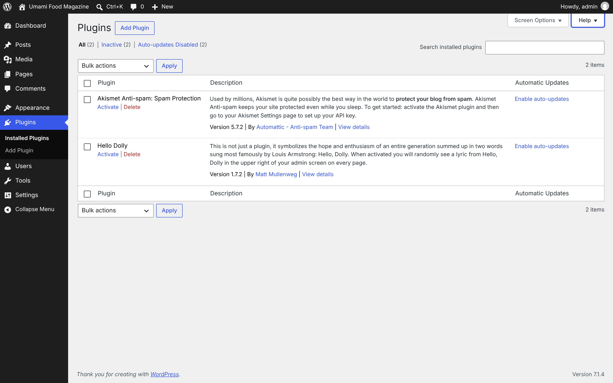
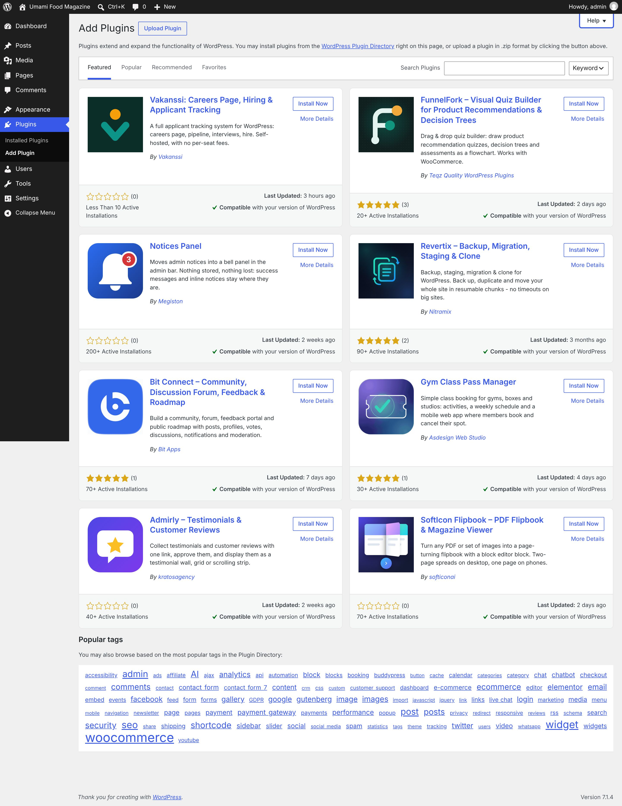

# Plugins

[← Overview](00-overview.md)

Top-level menu **Plugins** → `plugins.php`

Submenu:
- Installed Plugins → `plugins.php`
- Add Plugin → `plugin-install.php`

Pages in this file:
- [Plugins](#plugins)
- [Add Plugin](#add-plugin)
- [Add New Plugin (search)](#add-new-plugin-search)

---

## Plugins

- **Menu path:** Plugins
- **URL:** `plugins.php`
- **Heading:** Plugins
- **Browser title:** Plugins ‹ Umami Food Magazine — WordPress
- **Tabs / filters:** All · Inactive · Auto-updates Disabled
- **Primary actions:** Apply · Add Plugin · Search installed plugins
- **List table columns:** Plugin · Description · Automatic Updates
- **Screen Options:** Columns Description Automatic Updates Pagination Number of items per page:
- **Help tabs:** Overview · Troubleshooting · Auto-updates · Dependencies



<details><summary>Form fields (9)</summary>

- Description
- Automatic Updates
- Number of items per page:
- Search installed plugins
- Select bulk action
- Current Page
- Select All
- Select Akismet Anti-spam: Spam Protection
- Select Hello Dolly

</details>

<details><summary>Page text</summary>

```text
Screen Options
Help
Plugins Add Plugin
Filter plugins list
All (2) | Inactive (2) | Auto-updates Disabled (2)

Search installed plugins

Select bulk action
Bulk actions
Activate
Deactivate
Update
Delete
Enable Auto-updates
Disable Auto-updates
2 items

Plugins list
Select All
	Plugin	Description	Automatic Updates

Select Akismet Anti-spam: Spam Protection
	
Akismet Anti-spam: Spam Protection
Activate | Delete
	

Used by millions, Akismet is quite possibly the best way in the world to protect your blog from spam. Akismet Anti-spam keeps your site protected even while you sleep. To get started: activate the Akismet plugin and then go to your Akismet Settings page to set up your API key.

Version 5.7.2 | By Automattic - Anti-spam Team | View details
	Enable auto-updates

Select Hello Dolly
	
Hello Dolly
Activate | Delete
	

This is not just a plugin, it symbolizes the hope and enthusiasm of an entire generation summed up in two words sung most famously by Louis Armstrong: Hello, Dolly. When activated you will randomly see a lyric from Hello, Dolly in the upper right of your admin screen on every page.

Version 1.7.2 | By Matt Mullenweg | View details
	Enable auto-updates

Select All
	Plugin	Description	Automatic Updates
Select bulk action
Bulk actions
Activate
Deactivate
Update
Delete
Enable Auto-updates
Disable Auto-updates
2 items
```

</details>

<details><summary>Help panel</summary>

**Overview**

Plugins extend and expand the functionality of WordPress. Once a plugin is installed, you may activate it or deactivate it here.
The search for installed plugins will search for terms in their name, description, or author. The search results will be updated as you type.
If you would like to see more plugins to choose from, click on the “Add Plugin” button and you will be able to browse or search for additional plugins from the WordPress Plugin Directory. Plugins in the WordPress Plugin Directory are designed and developed by third parties, and are compatible with the license WordPress uses. Oh, and they are free!

**Troubleshooting**

Most of the time, plugins play nicely with the core of WordPress and with other plugins. Sometimes, though, a plugin’s code will get in the way of another plugin, causing compatibility issues. If your site starts doing strange things, this may be the problem. Try deactivating all your plugins and re-activating them in various combinations until you isolate which one(s) caused the issue.If something goes wrong with a plugin and you cannot use WordPress, delete or rename that file in the /home/user/dwordpress-admin/wordpress/wp-content/plugins directory and it will be automatically deactivated.

**Auto-updates**

Auto-updates can be enabled or disabled for each individual plugin. Plugins with auto-updates enabled will display the estimated date of the next auto-update. Auto-updates depends on the WP-Cron task scheduling system.Auto-updates are only available for plugins recognized by WordPress.org, or that include a compatible update system.Please note: Third-party themes and plugins, or custom code, may override WordPress scheduling.

**Dependencies**

Plugin Dependencies aims to make the process of installing and activating add-ons (dependents) and the plugins they rely on (dependencies) consistent and easy.If a required plugin is deleted, a notice will be displayed on the Plugin administration screen informing the user that there is some missing dependencies to install and/or activate. Additionally, each plugin whose dependencies are not met will have an error notice on their plugin row.If a dependent plugin is missing some dependencies, its activation button will be disabled until the required dependencies are activated.

</details>

---

## Add Plugin

- **Menu path:** Plugins → Add Plugin
- **URL:** `plugin-install.php`
- **Heading:** Add Plugins
- **Browser title:** Add Plugins ‹ Umami Food Magazine — WordPress
- **Primary actions:** Upload Plugin · Install Now · Search Plugins
- **Help tabs:** Overview · Adding Plugins



<details><summary>Form fields (3)</summary>

- Plugin zip file
- Search Plugins
- Search plugins by:

</details>

<details><summary>Page text</summary>

```text
Help
Add Plugins Upload Plugin
Filter plugins list

Plugins extend and expand the functionality of WordPress. You may install plugins from the WordPress Plugin Directory right on this page, or upload a plugin in .zip format by clicking the button above.

Featured Popular Recommended Favorites
Search Plugins
Search plugins by:
Keyword
Author
Tag

Plugins list
Vakanssi: Careers Page, Hiring & Applicant Tracking
Install Now
More Details

A full applicant tracking system for WordPress: careers page, pipeline, interviews, hire. Self-hosted, with no per-seat fees.

By Vakanssi

0.0 rating
 (0)
Last Updated: 3 hours ago
Less Than 10 Active Installations
Compatible with your version of WordPress
FunnelFork – Visual Quiz Builder for Product Recommendations & Decision Trees
Install Now
More Details

Drag & drop quiz builder: draw product recommendation quizzes, decision trees and assessments as a flowchart. Works with WooCommerce.

By Teqz Quality WordPress Plugins

5.0 rating based on 3 ratings
 (3)
Last Updated: 2 days ago
20+ Active Installations
Compatible with your version of WordPress
Notices Panel
Install Now
More Details

Moves admin notices into a bell panel in the admin bar. Nothing stored, nothing lost: success messages and inline notices stay where they are.

By Megiston

0.0 rating
 (0)
Last Updated: 2 weeks ago
200+ Active Installations
Compatible with your version of WordPress
Revertix – Backup, Migration, Staging & Clone
Install Now
More Details

Backup, staging, migration & clone for WordPress. Back up, duplicate and move your whole site in resumable chunks - no timeouts on big sites.

By Nitramix

5.0 rating based on 2 ratings
 (2)
Last Updated: 3 months ago
90+ Active Installations
Compatible with your version of WordPress
Bit Connect – Community, Discussion Forum, Feedback & Roadmap
Install Now
More Details

Build a community, forum, feedback portal and public roadmap with posts, profiles, votes, discussions, notifications and moderation.

By Bit Apps

5.0 rating based on 1 rating
 (1)
Last Updated: 7 days ago
70+ Active Installations
Compatible with your version of WordPress
Gym Class Pass Manager
Install Now
More Details

Simple class booking for gyms, boxes and studios: activities, a weekly schedule and a mobile web app where members book and cancel their spot.

By Asdesign Web Studio

5.0 rating based on 1 rating
 (1)
Last Updated: 4 days ago
30+ Active Installations
Compatible with your version of WordPress
Admirly – Testimonials & Customer Reviews
Install Now
More Details

Collect testimonials and customer reviews with one link, approve them, and display them as a testimonial wall, grid or scrolling strip.

By kratosagency

0.0 rating
 (0)
Last Updated: 2 weeks ago
40+ Active Installations
Compatible with your version of WordPress
SoftIcon Flipbook – PDF Flipbook & Magazine Viewer
Install Now
More Details

Turn any PDF or set of images into a page-turning flipbook with a block editor block. Two-page spreads on desktop, one page on phones.

By softiconai

0.0 rating
 (0)
Last Updated: 2 days ago
70+ Active Installations
Compatible with your version of WordPress
Popular tags

You may also browse based on the most popular tags in the Plugin Directory:

accessibility admin ads affiliate AI ajax analytics api automation block blocks booking buddypress button cache calendar categories category chat chatbot checkout comment comments contact contact form contact form 7 content crm css custom customer support dashboard e-commerce ecommerce editor elementor email embed events facebook feed form forms gallery GDPR google gutenberg image images import javascript jquery link links live chat login marketing media menu mobile navigation newsletter page pages payment payment gateway payments performance popup post posts privacy redirect responsive reviews rss schema search security seo share shipping shortcode sidebar slider social social media spam statistics tags theme tracking twitter users video whatsapp widget widgets woo
```

</details>

<details><summary>Help panel</summary>

**Overview**

Plugins hook into WordPress to extend its functionality with custom features. Plugins are developed independently from the core WordPress application by thousands of developers all over the world. All plugins in the official WordPress Plugin Directory are compatible with the license WordPress uses.
You can find new plugins to install by searching or browsing the directory right here in your own Plugins section. The search results will be updated as you type.

**Adding Plugins**

If you know what you are looking for, Search is your best bet. The Search screen has options to search the WordPress Plugin Directory for a particular Term, Author, or Tag. You can also search the directory by selecting popular tags. Tags in larger type mean more plugins have been labeled with that tag.If you just want to get an idea of what’s available, you can browse Featured and Popular plugins by using the links above the plugins list. These sections rotate regularly.You can also browse a user’s favorite plugins, by using the Favorites link above the plugins list and entering their WordPress.org username.If you want to install a plugin that you’ve downloaded elsewhere, click the Upload Plugin button above the plugins list. You will be prompted to upload the .zip package, and once uploaded, you can activate the new plugin.

</details>

---

## Add New Plugin (search)

- **Menu path:** Plugins → Add New Plugin (search)
- **URL:** `plugin-install.php?tab=search&s=seo`
- **Heading:** Add Plugins
- **Browser title:** Add Plugins ‹ Umami Food Magazine — WordPress
- **Primary actions:** Upload Plugin · Install Now · Search Plugins
- **Help tabs:** Overview · Adding Plugins


<details><summary>Form fields (4)</summary>

- Plugin zip file
- Search Plugins
- Search plugins by:
- Current Page

</details>

<details><summary>Page text</summary>

```text
Help
Add Plugins Upload Plugin
Filter plugins list

Plugins extend and expand the functionality of WordPress. You may install plugins from the WordPress Plugin Directory right on this page, or upload a plugin in .zip format by clicking the button above.

Search Results Featured Popular Recommended Favorites
Search Plugins
Search plugins by:
Keyword
Author
Tag
Plugins list navigation
9,054 items « ‹ 
Current Page
 of 252 
Next page
› 
Last page
»

Plugins list
Rank Math SEO – AI SEO Tools to Dominate SEO Rankings
Install Now
More Details

Grow your organic traffic and AI visibility with powerful SEO tools, XML sitemaps, Schema automation, and built-in AI SEO, all in one place.

By Rank Math SEO

5.0 rating based on 7,522 ratings
 (7,522)
Last Updated: 2 days ago
4+ Million Active Installations
Compatible with your version of WordPress
Yoast SEO – Advanced SEO with real-time guidance and built-in AI
Install Now
More Details

Real-time SEO guidance, schema, and AI built in. Help search engines and AI systems understand your content. All AI tools included, no hidden fees.

By Yoast

5.0 rating based on 27,820 ratings
 (27,820)
Last Updated: 1 week ago
10+ Million Active Installations
Compatible with your version of WordPress
All in One SEO – AI SEO Plugin to Boost SEO Rankings & Traffic (Schema, Local SEO, Sitemap & SEO Insights)
Install Now
More Details

AIOSEO is the WordPress SEO plugin. Boost SEO rankings with AI SEO tools, schema, meta descriptions, XML sitemaps & rank tracking.

By Syed Balkhi

4.5 rating based on 5,231 ratings
 (5,231)
Last Updated: 17 hours ago
2+ Million Active Installations
Compatible with your version of WordPress
The SEO Framework – Fast, Automated, Effortless.
Install Now
More Details

The fastest feature-complete SEO plugin for professional WordPress websites. Secure, fast, unbranded, and automated SEO. Do less; get better results.

By Sybre Waaijer

5.0 rating based on 380 ratings
 (380)
Last Updated: 3 weeks ago
200,000+ Active Installations
Compatible with your version of WordPress
SEOPress – AI SEO Plugin & On-site SEO
Install Now
More Details

WordPress SEO plugin with AI SEO metadata, schema, XML sitemap, redirections & Search Console. Privacy-first, white-label SEO. Now AI-ready.

By Benjamin Denis

5.0 rating based on 1,268 ratings
 (1,268)
Last Updated: 7 days ago
300,000+ Active Installations
Compatible with your version of WordPress
Slim SEO – AI SEO Plugin, Lightweight, Fast & Automated
Install Now
More Details

An AI SEO plugin for WordPress that's lightweight and fast. Automatically generates meta tags, sitemaps, schemas and more with no bloat.

By Anh Tran

4.5 rating based on 136 ratings
 (136)
Last Updated: 5 hours ago
70,000+ Active Installations
Compatible with your version of WordPress
LiteSpeed Cache
Install Now
More Details

All-in-one unbeatable acceleration & PageSpeed improvement: caching, image/CSS/JS optimization...

By LiteSpeed Technologies

5.0 rating based on 2,778 ratings
 (2,778)
Last Updated: 1 day ago
7+ Million Active Installations
Compatible with your version of WordPress
GEO Plugin by Squirrly SEO
Install Now
More Details

Become the brand AI recommends. SEO + AEO + GEO so your WordPress ranks on Google and gets cited by ChatGPT, Perplexity, Gemini & AI Overviews.

By SEO Squirrly

4.5 rating based on 683 ratings
 (683)
Last Updated: 2 days ago
30,000+ Active Installations
Untested with your version of WordPress
Xagio SEO & AEO – AI SEO for Google Rankings & AI Visibility
Install Now
More Details

AI powered meta, clustering, content, schema & rank tracking, plus an AI website builder - the AI SEO weapon most WordPress users haven't found yet.

By Xagio SEO

5.0 rating based on 51 ratings
 (51)
Last Updated: 10 hours ago
10,000+ Active Installations
Untested with your version of WordPress
Jetpack – AI Agents & MCP, Security, Backup & Analytics
Install Now
More Details

Connect ChatGPT, Claude, or another AI agent to your site. Plus backup, malware scan, firewall,
```

</details>

<details><summary>Help panel</summary>

**Overview**

Plugins hook into WordPress to extend its functionality with custom features. Plugins are developed independently from the core WordPress application by thousands of developers all over the world. All plugins in the official WordPress Plugin Directory are compatible with the license WordPress uses.
You can find new plugins to install by searching or browsing the directory right here in your own Plugins section. The search results will be updated as you type.

**Adding Plugins**

If you know what you are looking for, Search is your best bet. The Search screen has options to search the WordPress Plugin Directory for a particular Term, Author, or Tag. You can also search the directory by selecting popular tags. Tags in larger type mean more plugins have been labeled with that tag.If you just want to get an idea of what’s available, you can browse Featured and Popular plugins by using the links above the plugins list. These sections rotate regularly.You can also browse a user’s favorite plugins, by using the Favorites link above the plugins list and entering their WordPress.org username.If you want to install a plugin that you’ve downloaded elsewhere, click the Upload Plugin button above the plugins list. You will be prompted to upload the .zip package, and once uploaded, you can activate the new plugin.

</details>
