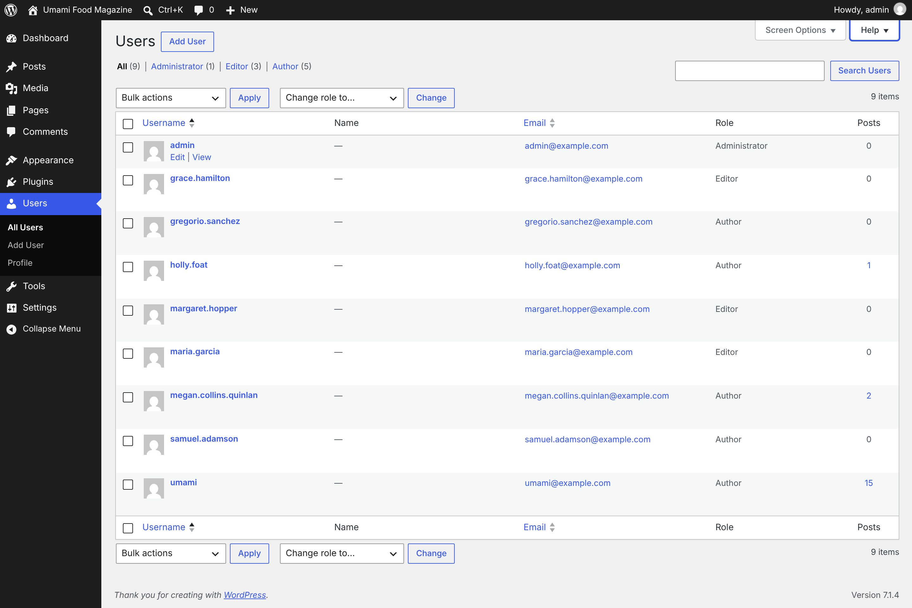
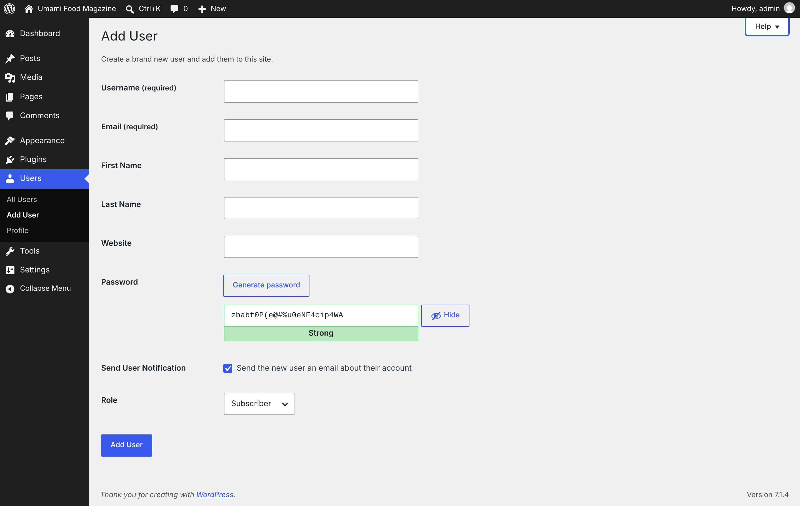
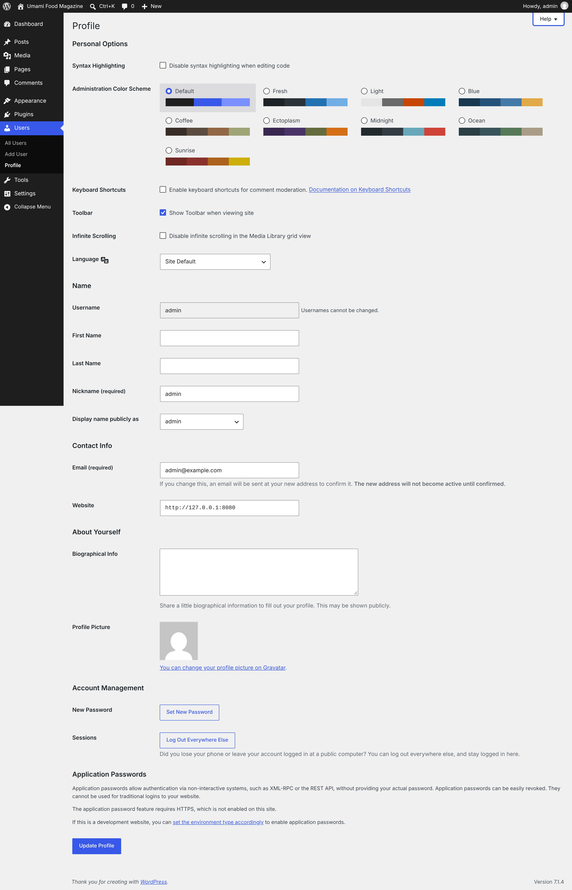
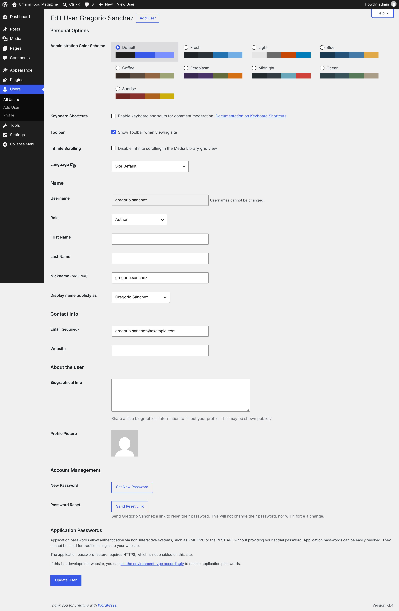

# Users

[← Overview](00-overview.md)

Top-level menu **Users** → `users.php`

Submenu:
- All Users → `users.php`
- Add User → `user-new.php`
- Profile → `profile.php`

Pages in this file:
- [Users](#users)
- [Add User](#add-user)
- [Profile](#profile)
- [Edit User](#edit-user)

---

## Users

- **Menu path:** Users
- **URL:** `users.php`
- **Heading:** Users
- **Browser title:** Users ‹ Umami Food Magazine — WordPress
- **Tabs / filters:** All · Administrator · Editor · Author
- **Primary actions:** Apply · Add User · Search Users · Change
- **List table columns:** Username · Name · Email · Role · Posts
- **Screen Options:** Columns Email Role Posts Pagination Number of items per page:
- **Help tabs:** Overview · Screen Content · Available Actions



<details><summary>Form fields (18)</summary>

- Email
- Role
- Posts
- Number of items per page:
- Search Users:
- Select bulk action
- Change role to…
- Current Page
- Select All
- Select admin
- Select grace.hamilton
- Select gregorio.sanchez
- Select holly.foat
- Select margaret.hopper
- Select maria.garcia
- Select megan.collins.quinlan
- Select samuel.adamson
- Select umami

</details>

<details><summary>Page text</summary>

```text
Screen Options
Help
Users Add User
Filter users list
All (9) | Administrator (1) | Editor (3) | Author (5)

Search Users:

Select bulk action
Bulk actions
Delete
Send password reset
Change role to…
Change role to…
Subscriber
Contributor
Author
Editor
Administrator
— No role for this site —
9 items

Users list
Table ordered by Username. Ascending.
Select All
	
Username
	Name	
Email
Sort ascending.
	Role	Posts

Select admin
	
admin

Edit | View
	—
Unknown
	admin@example.com	Administrator	0

Select grace.hamilton
	
grace.hamilton

Edit | Delete | View | Send password reset
	—
Unknown
	grace.hamilton@example.com	Editor	0

Select gregorio.sanchez
	
gregorio.sanchez

Edit | Delete | View | Send password reset
	—
Unknown
	gregorio.sanchez@example.com	Author	0

Select holly.foat
	
holly.foat

Edit | Delete | View | Send password reset
	—
Unknown
	holly.foat@example.com	Author	1
1 post by this author

Select margaret.hopper
	
margaret.hopper

Edit | Delete | View | Send password reset
	—
Unknown
	margaret.hopper@example.com	Editor	0

Select maria.garcia
	
maria.garcia

Edit | Delete | View | Send password reset
	—
Unknown
	maria.garcia@example.com	Editor	0

Select megan.collins.quinlan
	
megan.collins.quinlan

Edit | Delete | View | Send password reset
	—
Unknown
	megan.collins.quinlan@example.com	Author	2
2 posts by this author

Select samuel.adamson
	
samuel.adamson

Edit | Delete | View | Send password reset
	—
Unknown
	samuel.adamson@example.com	Author	0

Select umami
	
umami

Edit | Delete | View | Send password reset
	—
Unknown
	umami@example.com	Author	15
15 posts by this author

Select All
	
Username
	Name	
Email
Sort ascending.
	Role	Posts
Select bulk action
Bulk actions
Delete
Send password reset
Change role to…
Change role to…
Subscriber
Contributor
Author
Editor
Administrator
— No role for this site —
9 items
```

</details>

<details><summary>Help panel</summary>

**Overview**

This screen lists all the existing users for your site. Each user has one of five defined roles as set by the site admin: Site Administrator, Editor, Author, Contributor, or Subscriber. Users with roles other than Administrator will see fewer options in the dashboard navigation when they are logged in, based on their role.
To add a new user for your site, click the Add User button at the top of the screen or Add User in the Users menu section.

**Screen Content**

You can customize the display of this screen in a number of ways:You can hide/display columns based on your needs and decide how many users to list per screen using the Screen Options tab.You can filter the list of users by User Role using the text links above the users list to show All, Administrator, Editor, Author, Contributor, or Subscriber. The default view is to show all users. Unused User Roles are not listed.You can view all posts made by a user by clicking on the number under the Posts column.

**Available Actions**

Hovering over a row in the users list will display action links that allow you to manage users. You can perform the following actions:Edit takes you to the editable profile screen for that user. You can also reach that screen by clicking on the username.Delete brings you to the Delete Users screen for confirmation, where you can permanently remove a user from your site and delete their content. You can also delete multiple users at once by using bulk actions.View takes you to a public author archive which lists all the posts published by the user.Send password reset sends the user an email with a link to set a new password.

</details>

---

## Add User

- **Menu path:** Users → Add User
- **URL:** `user-new.php`
- **Heading:** Add User
- **Browser title:** Add User ‹ Umami Food Magazine — WordPress
- **Primary actions:** Add User
- **Help tabs:** Overview · User Roles



<details><summary>Form fields (10)</summary>

- Username (required)
- Email (required)
- First Name
- Last Name
- Website
- Password
- Repeat Password (required)
- Confirm use of weak password
- Send the new user an email about their account
- Role

</details>

<details><summary>Page text</summary>

```text
Help
Add User

Create a brand new user and add them to this site.

Username (required)	
Email (required)	
First Name	
Last Name	
Website	
Password	Generate password
Strong
 
Hide

Send User Notification	 Send the new user an email about their account
Role	
Subscriber
Contributor
Author
Editor
Administrator
```

</details>

<details><summary>Help panel</summary>

**Overview**

To add a new user to your site, fill in the form on this screen and click the Add User button at the bottom.
New users are automatically assigned a password, which they can change after logging in. You can view or edit the assigned password by clicking the Show Password button. The username cannot be changed once the user has been added.
By default, new users will receive an email letting them know they’ve been added as a user for your site. This email will also contain a password reset link. Uncheck the box if you do not want to send the new user a welcome email.
Remember to click the Add User button at the bottom of this screen when you are finished.

**User Roles**

Here is a basic overview of the different user roles and the permissions associated with each one:Subscribers can read comments/comment/receive newsletters, etc. but cannot create regular site content.Contributors can write and manage their posts but not publish posts or upload media files.Authors can publish and manage their own posts, and are able to upload files.Editors can publish posts, manage posts as well as manage other people’s posts, etc.Administrators have access to all the administration features.

</details>

---

## Profile

- **Menu path:** Users → Profile
- **URL:** `profile.php`
- **Heading:** Profile
- **Browser title:** Profile ‹ Umami Food Magazine — WordPress
- **Primary actions:** Update Profile
- **Help tabs:** Overview



<details><summary>Form fields (25)</summary>

- Disable syntax highlighting when editing code
- Default
- Fresh
- Light
- Blue
- Coffee
- Ectoplasm
- Midnight
- Ocean
- Sunrise
- Enable keyboard shortcuts for comment moderation.
- Show Toolbar when viewing site
- Disable infinite scrolling in the Media Library grid view
- Language
- Username
- First Name
- Last Name
- Nickname (required)
- Display name publicly as
- Email (required)
- Website
- Biographical Info
- New Password
- Repeat New Password
- Confirm use of weak password

</details>

<details><summary>Page text</summary>

```text
Help
Profile

Personal Options
Syntax Highlighting	 Disable syntax highlighting when editing code
Administration Color Scheme	
Administration Color Scheme
 Default
 	 	 
  Fresh
 	 	 	 
  Light
 	 	 	 
  Blue
 	 	 	 
  Coffee
 	 	 	 
  Ectoplasm
 	 	 	 
  Midnight
 	 	 	 
  Ocean
 	 	 	 
  Sunrise
 	 	 	 

Keyboard Shortcuts	 Enable keyboard shortcuts for comment moderation. Documentation on Keyboard Shortcuts
Toolbar	 Show Toolbar when viewing site

Infinite Scrolling	 Disable infinite scrolling in the Media Library grid view
Language	
Site Default
English (United States)
Afrikaans
አማርኛ
Aragonés
العربية
العربية المغربية
অসমীয়া
گؤنئی آذربایجان
Azərbaycan dili
Беларуская мова
Български
বাংলা
བོད་ཡིག
Bosanski
Català
Català (Valencià)
Cebuano
Čeština
Cymraeg
Dansk
Deutsch (Österreich)
Deutsch (Schweiz)
Deutsch (Sie)
Deutsch
Deutsch (Schweiz, Du)
Dolnoserbšćina
རྫོང་ཁ
Ελληνικά
English (Australia)
English (New Zealand)
English (South Africa)
English (Canada)
English (UK)
Esperanto
Español de Argentina
Español de México
Español de Chile
Español de Colombia
Español de Perú
Español de Venezuela
Español de Ecuador
Español de República Dominicana
Español de Uruguay
Español de Puerto Rico
Español de Guatemala
Español
Español de Costa Rica
Eesti
Euskara
فارسی
(فارسی (افغانستان
Suomi
Føroyskt
Français du Canada
Français
Français de Belgique
Friulian
Frysk
Gàidhlig
Galego
ગુજરાતી
هزاره گی
עִבְרִית
हिन्दी
Hrvatski
Hornjoserbšćina
Magyar
Հայերեն
Bahasa Indonesia
Íslenska
Italiano
日本語
Basa Jawa
ქართული
Taqbaylit
Қазақ тілі
ភាសាខ្មែរ
ಕನ್ನಡ
한국어
كوردی‎
Кыргызча
ພາສາລາວ
Lietuvių kalba
Latviešu valoda
Македонски јазик
മലയാളം
Монгол
मराठी
Bahasa Melayu
ဗမာစာ
Norsk bokmål
नेपाली
Nederlands
Nederlands (België)
Nederlands (Formeel)
Norsk nynorsk
Occitan
ਪੰਜਾਬੀ
Nigerian Pidgin
Polski
پښتو
Português
Português (AO90)
Português do Brasil
Português de Angola
Ruáinga
Română
Русский
Сахалыы
سنڌي
සිංහල
Slovenčina
سرائیکی
Slovenščina
Shqip
Српски језик
Svenska
Kiswahili
Ślōnskŏ gŏdka
தமிழ்
தமிழ்
తెలుగు
ไทย
Tagalog
Türkçe
Татар теле
Reo Tahiti
ئۇيغۇرچە
Українська
اردو
O‘zbekcha
Tiếng Việt
Yorùbá
简体中文
繁體中文
香港中文
Name
Username	 Usernames cannot be changed.
First Name	
Last Name	
Nickname (required)	
Display name publicly as	
admin
Contact Info
Email (required)	

If you change this, an email will be sent at your new address to confirm it. The new address will not become active until confirmed.

Website	
About Yourself
Biographical Info	

Share a little biographical information to fill out your profile. This may be shown publicly.

Profile Picture	

You can change your profile picture on Gravatar.

Account Management
New Password	Set New Password
Sessions	
Log Out Everywhere Else

Did you lose your phone or leave your account logged in at a public computer? You can log out everywhere else, and stay logged in here.

Application Passwords

Application passwords allow authentication via non-interactive systems, such as XML-RPC or the REST API, without providing your actual password. Application passwords can be easily revoked. They cannot be used for traditional logins to your website.

The application password feature requires HTTPS, which is not enabled on this site.

If this is a development website, you can set the environment type accordingly to enable application passwords.
```

</details>

<details><summary>Help panel</summary>

**Overview**

Your profile contains information about you (your “account”) as well as some personal options related to using WordPress.
You can change your password, turn on keyboard shortcuts, change the color scheme of your WordPress administration screens, and turn off the WYSIWYG (Visual) editor, among other things. You can hide the Toolbar (formerly called the Admin Bar) from the front end of your site, however it cannot be disabled on the admin screens.
You can select the language you wish to use while using the WordPress administration screen without affecting the language site visitors see.
Your username cannot be changed, but you can use other fields to enter your real name or a nickname, and change which name to display on your posts.
You can log out of other devices, such as your phone or a public computer, by clicking the Log Out Everywhere Else button.
Required fields are indicated; the rest are optional. Profile information will only be displayed if your theme is set up to do so.
Remember to click the Update Profile button when you are finished.

</details>

---

## Edit User

- **Menu path:** Users → Edit User
- **URL:** `user-edit.php?user_id=2`
- **Heading:** Edit User Gregorio Sánchez
- **Browser title:** Edit User Gregorio Sánchez ‹ Umami Food Magazine — WordPress
- **Primary actions:** Add User · Update User
- **Help tabs:** Overview



<details><summary>Form fields (25)</summary>

- Default
- Fresh
- Light
- Blue
- Coffee
- Ectoplasm
- Midnight
- Ocean
- Sunrise
- Enable keyboard shortcuts for comment moderation.
- Show Toolbar when viewing site
- Disable infinite scrolling in the Media Library grid view
- Language
- Username
- Role
- First Name
- Last Name
- Nickname (required)
- Display name publicly as
- Email (required)
- Website
- Biographical Info
- New Password
- Repeat New Password
- Confirm use of weak password

</details>

<details><summary>Page text</summary>

```text
Help
Edit User Gregorio Sánchez Add User

Personal Options
Administration Color Scheme	
Administration Color Scheme
 Default
 	 	 
  Fresh
 	 	 	 
  Light
 	 	 	 
  Blue
 	 	 	 
  Coffee
 	 	 	 
  Ectoplasm
 	 	 	 
  Midnight
 	 	 	 
  Ocean
 	 	 	 
  Sunrise
 	 	 	 

Keyboard Shortcuts	 Enable keyboard shortcuts for comment moderation. Documentation on Keyboard Shortcuts
Toolbar	 Show Toolbar when viewing site

Infinite Scrolling	 Disable infinite scrolling in the Media Library grid view
Language	
Site Default
English (United States)
Afrikaans
አማርኛ
Aragonés
العربية
العربية المغربية
অসমীয়া
گؤنئی آذربایجان
Azərbaycan dili
Беларуская мова
Български
বাংলা
བོད་ཡིག
Bosanski
Català
Català (Valencià)
Cebuano
Čeština
Cymraeg
Dansk
Deutsch (Österreich)
Deutsch (Schweiz)
Deutsch (Sie)
Deutsch
Deutsch (Schweiz, Du)
Dolnoserbšćina
རྫོང་ཁ
Ελληνικά
English (Australia)
English (New Zealand)
English (South Africa)
English (Canada)
English (UK)
Esperanto
Español de Argentina
Español de México
Español de Chile
Español de Colombia
Español de Perú
Español de Venezuela
Español de Ecuador
Español de República Dominicana
Español de Uruguay
Español de Puerto Rico
Español de Guatemala
Español
Español de Costa Rica
Eesti
Euskara
فارسی
(فارسی (افغانستان
Suomi
Føroyskt
Français du Canada
Français
Français de Belgique
Friulian
Frysk
Gàidhlig
Galego
ગુજરાતી
هزاره گی
עִבְרִית
हिन्दी
Hrvatski
Hornjoserbšćina
Magyar
Հայերեն
Bahasa Indonesia
Íslenska
Italiano
日本語
Basa Jawa
ქართული
Taqbaylit
Қазақ тілі
ភាសាខ្មែរ
ಕನ್ನಡ
한국어
كوردی‎
Кыргызча
ພາສາລາວ
Lietuvių kalba
Latviešu valoda
Македонски јазик
മലയാളം
Монгол
मराठी
Bahasa Melayu
ဗမာစာ
Norsk bokmål
नेपाली
Nederlands
Nederlands (België)
Nederlands (Formeel)
Norsk nynorsk
Occitan
ਪੰਜਾਬੀ
Nigerian Pidgin
Polski
پښتو
Português
Português (AO90)
Português do Brasil
Português de Angola
Ruáinga
Română
Русский
Сахалыы
سنڌي
සිංහල
Slovenčina
سرائیکی
Slovenščina
Shqip
Српски језик
Svenska
Kiswahili
Ślōnskŏ gŏdka
தமிழ்
தமிழ்
తెలుగు
ไทย
Tagalog
Türkçe
Татар теле
Reo Tahiti
ئۇيغۇرچە
Українська
اردو
O‘zbekcha
Tiếng Việt
Yorùbá
简体中文
繁體中文
香港中文
Name
Username	 Usernames cannot be changed.
Role	
Subscriber
Contributor
Author
Editor
Administrator
— No role for this site —

First Name	
Last Name	
Nickname (required)	
Display name publicly as	
Gregorio Sánchez
gregorio.sanchez
Contact Info
Email (required)	
Website	
About the user
Biographical Info	

Share a little biographical information to fill out your profile. This may be shown publicly.

Profile Picture	

Account Management
New Password	Set New Password
Password Reset	
Send Reset Link

Send Gregorio Sánchez a link to reset their password. This will not change their password, nor will it force a change.

Application Passwords

Application passwords allow authentication via non-interactive systems, such as XML-RPC or the REST API, without providing your actual password. Application passwords can be easily revoked. They cannot be used for traditional logins to your website.

The application password feature requires HTTPS, which is not enabled on this site.

If this is a development website, you can set the environment type accordingly to enable application passwords.
```

</details>

<details><summary>Help panel</summary>

**Overview**

Your profile contains information about you (your “account”) as well as some personal options related to using WordPress.
You can change your password, turn on keyboard shortcuts, change the color scheme of your WordPress administration screens, and turn off the WYSIWYG (Visual) editor, among other things. You can hide the Toolbar (formerly called the Admin Bar) from the front end of your site, however it cannot be disabled on the admin screens.
You can select the language you wish to use while using the WordPress administration screen without affecting the language site visitors see.
Your username cannot be changed, but you can use other fields to enter your real name or a nickname, and change which name to display on your posts.
You can log out of other devices, such as your phone or a public computer, by clicking the Log Out Everywhere Else button.
Required fields are indicated; the rest are optional. Profile information will only be displayed if your theme is set up to do so.
Remember to click the Update Profile button when you are finished.

</details>
