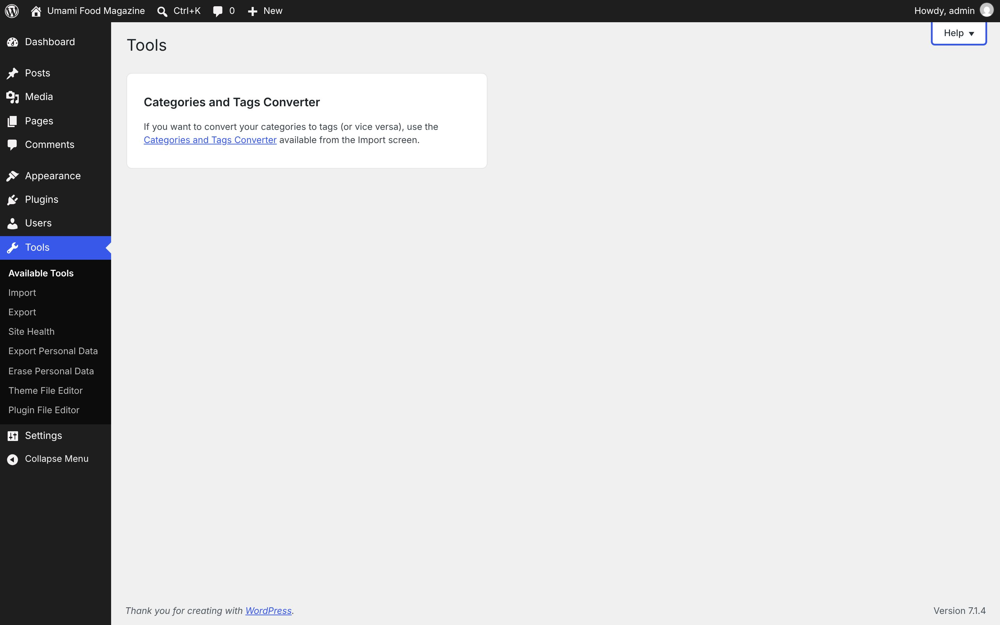
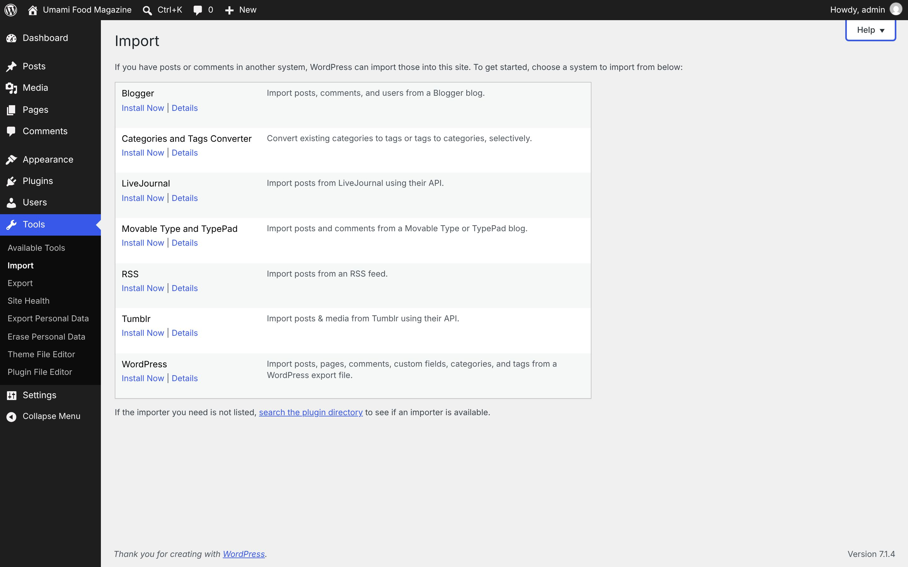
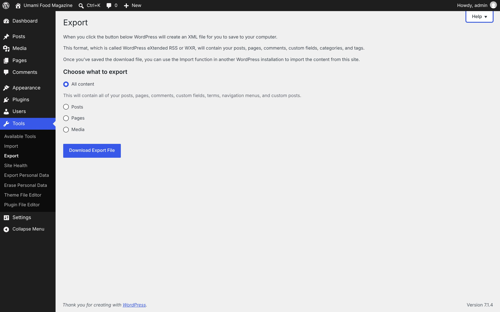
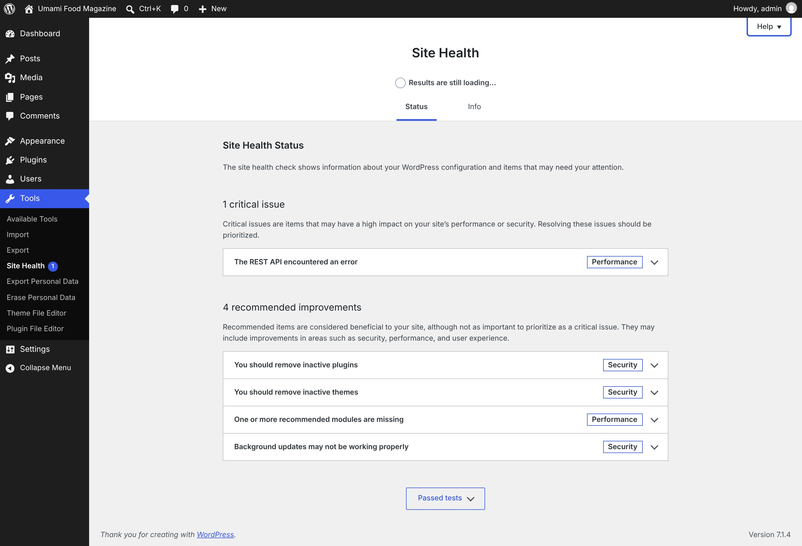
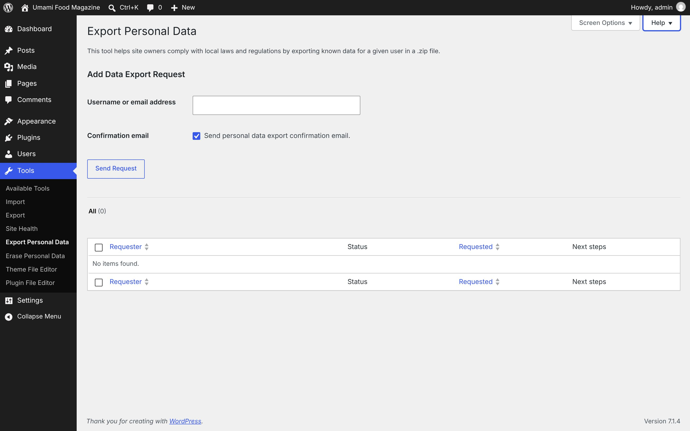
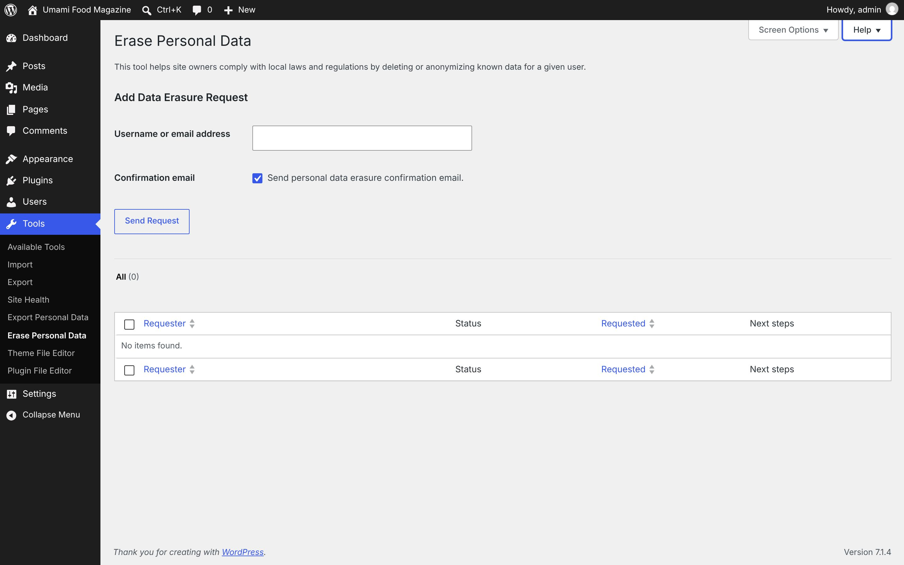
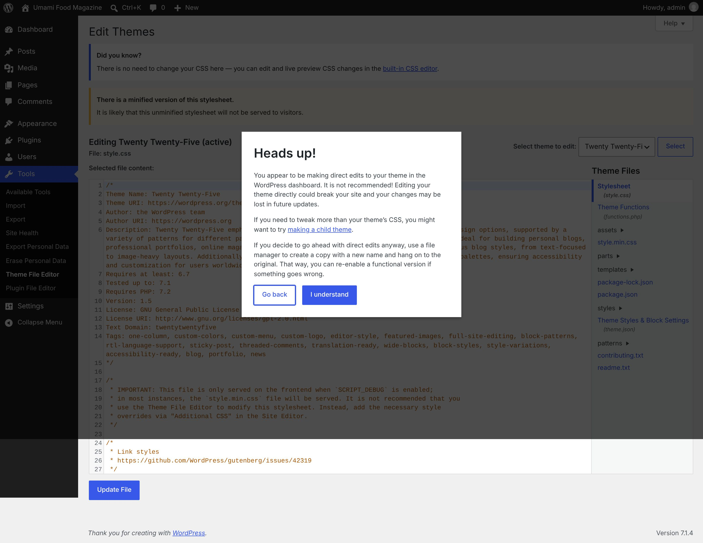
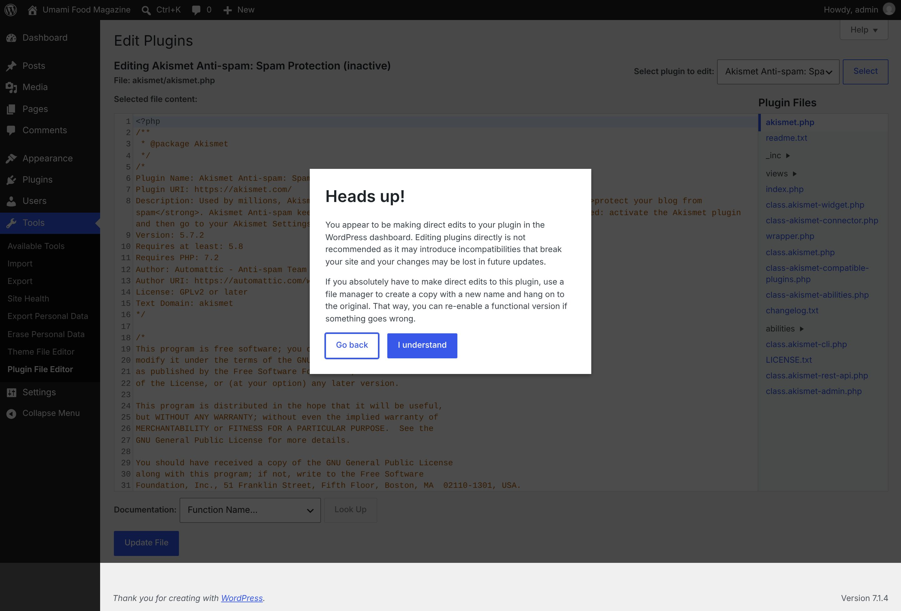
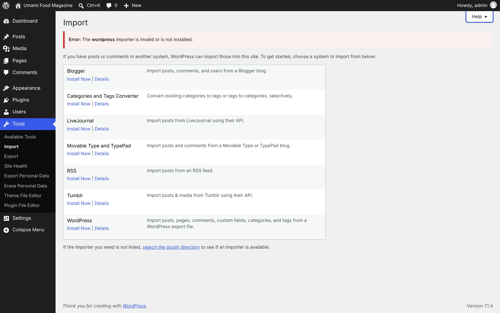

# Tools

[← Overview](00-overview.md)

Top-level menu **Tools** → `tools.php`

Submenu:
- Available Tools → `tools.php`
- Import → `import.php`
- Export → `export.php`
- Site Health → `site-health.php`
- Export Personal Data → `export-personal-data.php`
- Erase Personal Data → `erase-personal-data.php`
- Theme File Editor → `theme-editor.php`
- Plugin File Editor → `plugin-editor.php`

Pages in this file:
- [Tools](#tools)
- [Import](#import)
- [Export](#export)
- [Site Health](#site-health)
- [Export Personal Data](#export-personal-data)
- [Erase Personal Data](#erase-personal-data)
- [Theme File Editor](#theme-file-editor)
- [Plugin File Editor](#plugin-file-editor)
- [Import → WordPress (installer)](#import-wordpress-installer)

---

## Tools

- **Menu path:** Tools
- **URL:** `tools.php`
- **Heading:** Tools
- **Browser title:** Tools ‹ Umami Food Magazine — WordPress
- **Help tabs:** Categories and Tags Converter



<details><summary>Page text</summary>

```text
Help
Tools
Categories and Tags Converter

If you want to convert your categories to tags (or vice versa), use the Categories and Tags Converter available from the Import screen.
```

</details>

<details><summary>Help panel</summary>

**Categories and Tags Converter**

Categories have hierarchy, meaning that you can nest sub-categories. Tags do not have hierarchy and cannot be nested. Sometimes people start out using one on their posts, then later realize that the other would work better for their content.
The Categories and Tags Converter link on this screen will take you to the Import screen, where that Converter is one of the plugins you can install. Once that plugin is installed, the Activate Plugin & Run Importer link will take you to a screen where you can choose to convert tags into categories or vice versa.

</details>

---

## Import

- **Menu path:** Tools → Import
- **URL:** `import.php`
- **Heading:** Import
- **Browser title:** Import ‹ Umami Food Magazine — WordPress
- **Help tabs:** Overview



<details><summary>Page text</summary>

```text
Help
Import

If you have posts or comments in another system, WordPress can import those into this site. To get started, choose a system to import from below:

Blogger
Install Now | Details
	
Import posts, comments, and users from a Blogger blog.

Categories and Tags Converter
Install Now | Details
	
Convert existing categories to tags or tags to categories, selectively.

LiveJournal
Install Now | Details
	
Import posts from LiveJournal using their API.

Movable Type and TypePad
Install Now | Details
	
Import posts and comments from a Movable Type or TypePad blog.

RSS
Install Now | Details
	
Import posts from an RSS feed.

Tumblr
Install Now | Details
	
Import posts & media from Tumblr using their API.

WordPress
Install Now | Details
	
Import posts, pages, comments, custom fields, categories, and tags from a WordPress export file.

If the importer you need is not listed, search the plugin directory to see if an importer is available.
```

</details>

<details><summary>Help panel</summary>

**Overview**

This screen lists links to plugins to import data from blogging/content management platforms. Choose the platform you want to import from, and click Install Now when you are prompted in the popup window. If your platform is not listed, click the link to search the plugin directory for other importer plugins to see if there is one for your platform.
In previous versions of WordPress, all importers were built-in. They have been turned into plugins since most people only use them once or infrequently.

</details>

---

## Export

- **Menu path:** Tools → Export
- **URL:** `export.php`
- **Heading:** Export
- **Browser title:** Export ‹ Umami Food Magazine — WordPress
- **Primary actions:** Download Export File
- **Help tabs:** Overview



<details><summary>Form fields (8)</summary>

- All content
- Posts
- Start date:
- End date:
- Status:
- Pages
- Authors: All admin (admin) Samuel Adamson (samuel.adamson)
- Media

</details>

<details><summary>Page text</summary>

```text
Help
Export

When you click the button below WordPress will create an XML file for you to save to your computer.

This format, which is called WordPress eXtended RSS or WXR, will contain your posts, pages, comments, custom fields, categories, and tags.

Once you’ve saved the download file, you can use the Import function in another WordPress installation to import the content from this site.

Choose what to export
Content to export

 All content

This will contain all of your posts, pages, comments, custom fields, terms, navigation menus, and custom posts.

 Posts

 Pages

 Media
```

</details>

<details><summary>Help panel</summary>

**Overview**

You can export a file of your site’s content in order to import it into another installation or platform. The export file will be an XML file format called WXR. Posts, pages, comments, custom fields, categories, and tags can be included. You can choose for the WXR file to include only certain posts or pages by setting the dropdown filters to limit the export by category, author, date range by month, or publishing status.
Once generated, your WXR file can be imported by another WordPress site or by another blogging platform able to access this format.

</details>

---

## Site Health

- **Menu path:** Tools → Site Health
- **URL:** `site-health.php`
- **Heading:** Site Health
- **Browser title:** Site Health - Status ‹ Umami Food Magazine — WordPress
- **Help tabs:** Overview



<details><summary>Page text</summary>

```text
Help
Site Health
Results are still loading…
Status
Info
Site Health Status

The site health check shows information about your WordPress configuration and items that may need your attention.

1 critical issue

Critical issues are items that may have a high impact on your site’s performance or security. Resolving these issues should be prioritized.

The REST API encountered an error
Performance
4 recommended improvements

Recommended items are considered beneficial to your site, although not as important to prioritize as a critical issue. They may include improvements in areas such as security, performance, and user experience.

You should remove inactive plugins
Security
You should remove inactive themes
Security
One or more recommended modules are missing
Performance
Background updates may not be working properly
Security
Passed tests
```

</details>

<details><summary>Help panel</summary>

**Overview**

This screen allows you to obtain a health diagnosis of your site, and displays an overall rating of the status of your installation.
In the Status tab, you can see critical information about your WordPress configuration, along with anything else that requires your attention.
In the Info tab, you will find all the details about the configuration of your WordPress site, server, and database. There is also an export feature that allows you to copy all of the information about your site to the clipboard, to help solve problems on your site when obtaining support.

</details>

---

## Export Personal Data

- **Menu path:** Tools → Export Personal Data
- **URL:** `export-personal-data.php`
- **Heading:** Export Personal Data
- **Browser title:** Export Personal Data ‹ Umami Food Magazine — WordPress
- **Tabs / filters:** All
- **Primary actions:** Apply · Send Request
- **List table columns:** Requester · Status · Requested · Next steps
- **Screen Options:** Columns Requester Status Requested Next steps Pagination Number of items per page:
- **Help tabs:** Overview · Default Data · Plugin Data



<details><summary>Form fields (9)</summary>

- Requester
- Status
- Requested
- Next steps
- Number of items per page:
- Username or email address
- Send personal data export confirmation email.
- Select bulk action
- Select All

</details>

<details><summary>Page text</summary>

```text
Screen Options
Help
Export Personal Data

This tool helps site owners comply with local laws and regulations by exporting known data for a given user in a .zip file.

Add Data Export Request
Username or email address	
Confirmation email	 Send personal data export confirmation email.

Filter export personal data list
All (0)

Export personal data list
Select All
	
Requester
Sort ascending.
	Status	
Requested
Sort ascending.
	Next steps
No items found.

Select All
	
Requester
Sort ascending.
	Status	
Requested
Sort ascending.
	Next steps
```

</details>

<details><summary>Help panel</summary>

**Overview**

This screen is where you manage requests for an export of personal data.
Privacy Laws around the world require businesses and online services to provide an export of some of the data they collect about an individual, and to deliver that export on request. The rights those laws enshrine are sometimes called the "Right of Data Portability". It allows individuals to obtain and reuse their personal data for their own purposes across different services. It allows them to move, copy or transfer personal data easily from one IT environment to another.
The tool associates data stored in WordPress with a supplied email address, including profile data and comments.
Note: Since this tool only gathers data from WordPress and participating plugins, you may need to do more to comply with export requests. For example, you should also send the requester some of the data collected from or stored with the 3rd party services your organization uses.

**Default Data**

WordPress collects (but never publishes) a limited amount of data from registered users who have logged in to the site. Generally, these users are people who contribute to the site in some way -- content, store management, and so on. With rare exceptions, these users do not include occasional visitors who might have registered to comment on articles or buy products. The data WordPress retains can include:Profile Information — user email address, username, display name, nickname, first name, last name, description/bio, and registration date.Community Events Location — The IP Address of the user, which populates the Upcoming Community Events dashboard widget with relevant information.Session Tokens — User login information, IP Addresses, Expiration Date, User Agent (Browser/OS), and Last Login.Comments — For user comments, Email Address, IP Address, User Agent (Browser/OS), Date/Time, Comment Content, and Content URL.Media — A list of URLs for media files the user uploads.

**Plugin Data**

Many plugins may collect or store personal data either in the WordPress database or remotely. Any Export Personal Data request should include data from plugins as well.If you are not sure, check the plugin documentation or contact the plugin author to see if the plugin collects data and if it supports the Data Exporter tool. This information may be available in the Privacy Policy Guide.If you are a plugin author, you can learn more about how to add the Personal Data Exporter to a plugin.

</details>

---

## Erase Personal Data

- **Menu path:** Tools → Erase Personal Data
- **URL:** `erase-personal-data.php`
- **Heading:** Erase Personal Data
- **Browser title:** Erase Personal Data ‹ Umami Food Magazine — WordPress
- **Tabs / filters:** All
- **Primary actions:** Apply · Send Request
- **List table columns:** Requester · Status · Requested · Next steps
- **Screen Options:** Columns Requester Status Requested Next steps Pagination Number of items per page:
- **Help tabs:** Overview · Default Data · Plugin Data



<details><summary>Form fields (9)</summary>

- Requester
- Status
- Requested
- Next steps
- Number of items per page:
- Username or email address
- Send personal data erasure confirmation email.
- Select bulk action
- Select All

</details>

<details><summary>Page text</summary>

```text
Screen Options
Help
Erase Personal Data

This tool helps site owners comply with local laws and regulations by deleting or anonymizing known data for a given user.

Add Data Erasure Request
Username or email address	
Confirmation email	 Send personal data erasure confirmation email.

Filter erase personal data list
All (0)

Erase personal data list
Select All
	
Requester
Sort ascending.
	Status	
Requested
Sort ascending.
	Next steps
No items found.

Select All
	
Requester
Sort ascending.
	Status	
Requested
Sort ascending.
	Next steps
```

</details>

<details><summary>Help panel</summary>

**Overview**

This screen is where you manage requests to erase personal data.
Privacy Laws around the world require businesses and online services to delete, anonymize, or forget the data they collect about an individual. The rights those laws enshrine are sometimes called the "Right to be Forgotten".
The tool associates data stored in WordPress with a supplied email address, including profile data and comments.
Note: As this tool only gathers data from WordPress and participating plugins, you may need to do more to comply with erasure requests. For example, you are also responsible for ensuring that data collected by or stored with the 3rd party services your organization uses gets deleted.

**Default Data**

WordPress collects (but never publishes) a limited amount of data from logged-in users but then deletes it or anonymizes it. That data can include:Profile Information — user email address, username, display name, nickname, first name, last name, description/bio, and registration date.Community Events Location — The IP Address of the user which is used for the Upcoming Community Events shown in the dashboard widget.Session Tokens — User login information, IP Addresses, Expiration Date, User Agent (Browser/OS), and Last Login.Comments — WordPress does not delete comments. The software does anonymize (but, again, never publishes) the associated Email Address, IP Address, and User Agent (Browser/OS).Media — A list of URLs for all media file uploads made by the user.

**Plugin Data**

Many plugins may collect or store personal data either in the WordPress database or remotely. Any Erase Personal Data request should delete data from plugins as well.If you are not sure, check the plugin documentation or contact the plugin author to see if the plugin collects data and if it supports the Data Eraser tool. This information may be available in the Privacy Policy Guide.If you are a plugin author, you can learn more about how to add the Personal Data Eraser to a plugin.

</details>

---

## Theme File Editor

- **Menu path:** Tools → Theme File Editor
- **URL:** `theme-editor.php`
- **Heading:** Edit Themes
- **Browser title:** Edit Themes ‹ Umami Food Magazine — WordPress
- **Primary actions:** Select · Update File
- **Help tabs:** Overview



<details><summary>Form fields (2)</summary>

- Select theme to edit:
- Selected file content:

</details>

<details><summary>Page text</summary>

```text
Help
Edit Themes

Did you know?

There is no need to change your CSS here — you can edit and live preview CSS changes in the built-in CSS editor.

There is a minified version of this stylesheet.

It is likely that this unminified stylesheet will not be served to visitors.

Editing Twenty Twenty-Five (active)
File: style.css
Select theme to edit: 
Twenty Twenty-Five
Twenty Twenty-Four
Twenty Twenty-Three
 

Theme Files
Stylesheet
(style.css)
Theme Functions
(functions.php)
assets
folder
style.min.css
parts
folder
templates
folder
package-lock.json
package.json
styles
folder
Theme Styles & Block Settings
(theme.json)
patterns
folder
contributing.txt
readme.txt
Selected file content:
1
/*
2
Theme Name: Twenty Twenty-Five
3
Theme URI: https://wordpress.org/themes/twentytwentyfive/
4
Author: the WordPress team
5
Author URI: https://wordpress.org
6
Description: Twenty Twenty-Five emphasizes simplicity and adaptability. It offers flexible design options, supported by a variety of patterns for different page types, such as services and landing pages, making it ideal for building personal blogs, professional portfolios, online magazines, or business websites. Its templates cater to various blog styles, from text-focused to image-heavy layouts. Additionally, it supports international typography and diverse color palettes, ensuring accessibility and customization for users worldwide.
7
Requires at least: 6.7
8
Tested up to: 7.1
9
Requires PHP: 7.2
10
Version: 1.5
11
License: GNU General Public License v2 or later
12
License URI: http://www.gnu.org/licenses/gpl-2.0.html
13
Text Domain: twentytwentyfive
14
Tags: one-column, custom-colors, custom-menu, custom-logo, editor-style, featured-images, full-site-editing, block-patterns, rtl-language-support, sticky-post, threaded-comments, translation-ready, wide-blocks, block-styles, style-variations, accessibility-ready, blog, portfolio, news
15
*/
16
​
17
/*
18
 * IMPORTANT: This file is only served on the frontend when `SCRIPT_DEBUG` is enabled;
19
 * in most instances, the `style.min.css` file will be served. It is not recommended that you
20
 * use the Theme File Editor to modify this stylesheet. Instead, add the necessary style
21
 * overrides via "Additional CSS" in the Site Editor.
22
 */
23
​
24
/*
25
 * Link styles
26
 * https://github.com/WordPress/gutenberg/issues/42319
27
 */
28
a {
29
    text-decoration-thickness: 1px !important;
30
    text-underline-offset: .1em;
31
}
32
​
33
/* Focus styles */
34
:where(.wp-site-blocks *:focus) {
35
    outline-width: 2px;
36
    outline-style: solid;
```

</details>

<details><summary>Help panel</summary>

**Overview**

You can use the theme file editor to edit the individual CSS and PHP files which make up your theme.Begin by choosing a theme to edit from the dropdown menu and clicking the Select button. A list then appears of the theme’s template files. Clicking once on any file name causes the file to appear in the large Editor box.For PHP files, you can use the documentation dropdown to select from functions recognized in that file. Look Up takes you to a web page with reference material about that particular function.When using a keyboard to navigate:In the editing area, the Tab key enters a tab character.To move away from this area, press the Esc key followed by the Tab key.Screen reader users: when in forms mode, you may need to press the Esc key twice.After typing in your edits, click Update File.Advice: Think very carefully about your site crashing if you are live-editing the theme currently in use.Upgrading to a newer version of the same theme will override changes made here. To avoid this, consider creating a child theme instead.

</details>

---

## Plugin File Editor

- **Menu path:** Tools → Plugin File Editor
- **URL:** `plugin-editor.php`
- **Heading:** Edit Plugins
- **Browser title:** Edit Plugins ‹ Umami Food Magazine — WordPress
- **Primary actions:** Select · Update File
- **Help tabs:** Overview



<details><summary>Form fields (3)</summary>

- Select plugin to edit:
- Selected file content:
- Documentation:

</details>

<details><summary>Page text</summary>

```text
Help
Edit Plugins
Editing Akismet Anti-spam: Spam Protection (inactive)
File: akismet/akismet.php
Select plugin to edit: 
Akismet Anti-spam: Spam Protection
Hello Dolly
 

Plugin Files
akismet.php
readme.txt
_inc
folder
views
folder
index.php
class.akismet-widget.php
class-akismet-connector.php
wrapper.php
class.akismet.php
class-akismet-compatible-plugins.php
class-akismet-abilities.php
changelog.txt
abilities
folder
class.akismet-cli.php
LICENSE.txt
class.akismet-rest-api.php
class.akismet-admin.php
Selected file content:
1
<?php
2
/**
3
 * @package Akismet
4
 */
5
/*
6
Plugin Name: Akismet Anti-spam: Spam Protection
7
Plugin URI: https://akismet.com/
8
Description: Used by millions, Akismet is quite possibly the best way in the world to <strong>protect your blog from spam</strong>. Akismet Anti-spam keeps your site protected even while you sleep. To get started: activate the Akismet plugin and then go to your Akismet Settings page to set up your API key.
9
Version: 5.7.2
10
Requires at least: 5.8
11
Requires PHP: 7.2
12
Author: Automattic - Anti-spam Team
13
Author URI: https://automattic.com/wordpress-plugins/
14
License: GPLv2 or later
15
Text Domain: akismet
16
*/
17
​
18
/*
19
This program is free software; you can redistribute it and/or
20
modify it under the terms of the GNU General Public License
21
as published by the Free Software Foundation; either version 2
22
of the License, or (at your option) any later version.
23
​
24
This program is distributed in the hope that it will be useful,
25
but WITHOUT ANY WARRANTY; without even the implied warranty of
26
MERCHANTABILITY or FITNESS FOR A PARTICULAR PURPOSE.  See the
27
GNU General Public License for more details.
28
​
29
You should have received a copy of the GNU General Public License
30
along with this program; if not, write to the Free Software
31
Foundation, Inc., 51 Franklin Street, Fifth Floor, Boston, MA  02110-1301, USA.
32
​
33
Copyright 2005-2025 Automattic, Inc.
34
*/
35
​
36
// Make sure we don't expose any info if called directly
37
if ( ! function_exists( 'add_action' ) ) {
38
    echo 'Hi there!  I\'m just a plugin, not much I can do when called directly.';
39
    exit;
40
}
Documentation: 
Function Name…
add_action()
define()
defined()
function_exists()
get_api_key()
init()
is_admin()
plugin_dir_path()
register_activation_hook()
register_deactivation_hook()
```

</details>

<details><summary>Help panel</summary>

**Overview**

You can use the plugin file editor to make changes to any of your plugins’ individual PHP files. Be aware that if you make changes, plugins updates will overwrite your customizations.Choose a plugin to edit from the dropdown menu and click the Select button. Click once on any file name to load it in the editor, and make your changes. Do not forget to save your changes (Update File) when you are finished.The documentation menu below the editor lists the PHP functions recognized in the plugin file. Clicking Look Up takes you to a web page about that particular function.When using a keyboard to navigate:In the editing area, the Tab key enters a tab character.To move away from this area, press the Esc key followed by the Tab key.Screen reader users: when in forms mode, you may need to press the Esc key twice.If you want to make changes but do not want them to be overwritten when the plugin is updated, you may be ready to think about writing your own plugin. For information on how to edit plugins, write your own from scratch, or just better understand their anatomy, check out the links below.

</details>

---

## Import → WordPress (installer)

- **Menu path:** Tools → Import → WordPress (installer)
- **URL:** `admin.php?import=wordpress` (redirects to `import.php?invalid=wordpress`)
- **Heading:** Import
- **Browser title:** Import ‹ Umami Food Magazine — WordPress
- **Help tabs:** Overview



<details><summary>Page text</summary>

```text
Help
Import

Error: The wordpress importer is invalid or is not installed.

If you have posts or comments in another system, WordPress can import those into this site. To get started, choose a system to import from below:

Blogger
Install Now | Details
	
Import posts, comments, and users from a Blogger blog.

Categories and Tags Converter
Install Now | Details
	
Convert existing categories to tags or tags to categories, selectively.

LiveJournal
Install Now | Details
	
Import posts from LiveJournal using their API.

Movable Type and TypePad
Install Now | Details
	
Import posts and comments from a Movable Type or TypePad blog.

RSS
Install Now | Details
	
Import posts from an RSS feed.

Tumblr
Install Now | Details
	
Import posts & media from Tumblr using their API.

WordPress
Install Now | Details
	
Import posts, pages, comments, custom fields, categories, and tags from a WordPress export file.

If the importer you need is not listed, search the plugin directory to see if an importer is available.
```

</details>

<details><summary>Help panel</summary>

**Overview**

This screen lists links to plugins to import data from blogging/content management platforms. Choose the platform you want to import from, and click Install Now when you are prompted in the popup window. If your platform is not listed, click the link to search the plugin directory for other importer plugins to see if there is one for your platform.
In previous versions of WordPress, all importers were built-in. They have been turned into plugins since most people only use them once or infrequently.

</details>
