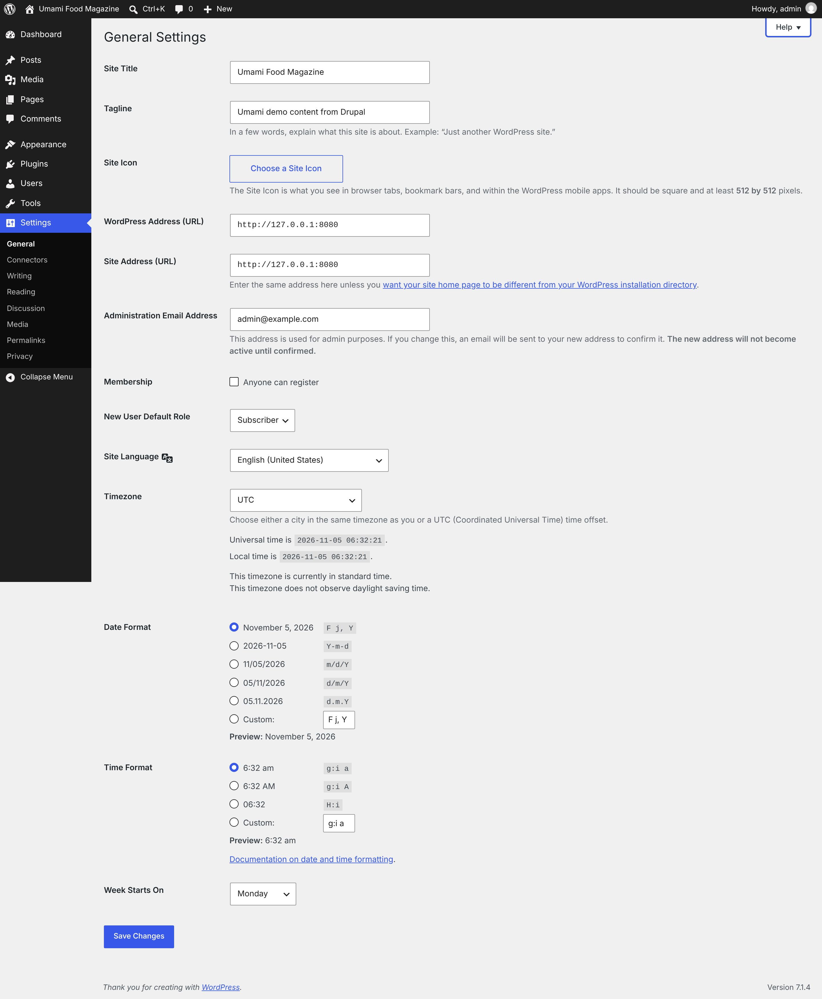
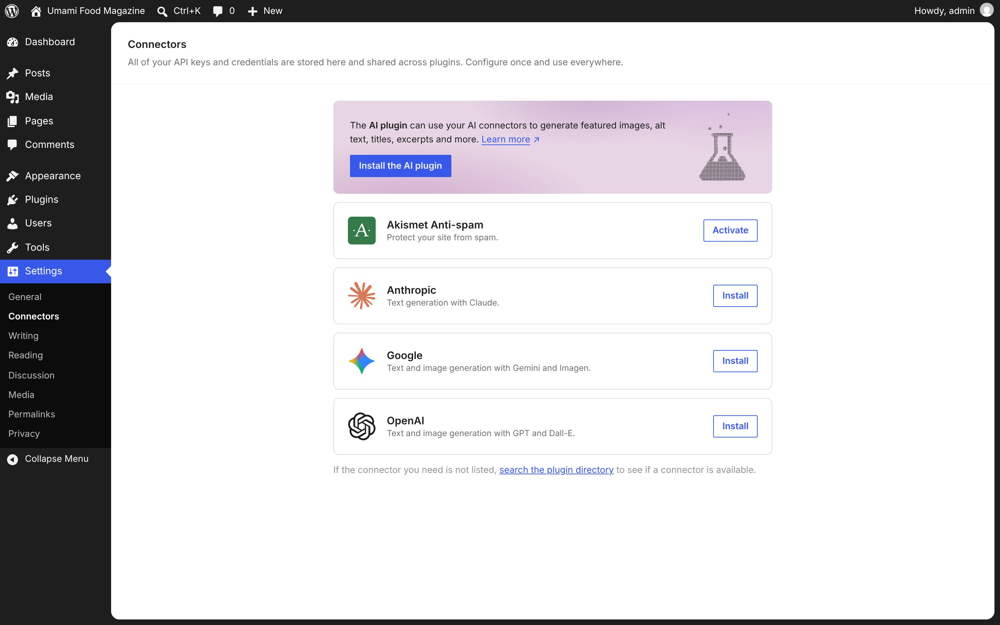
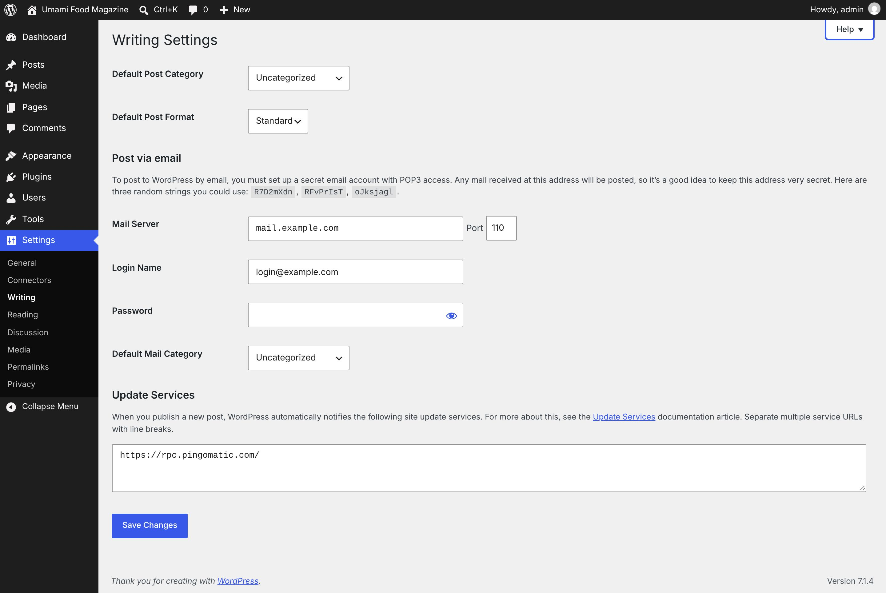
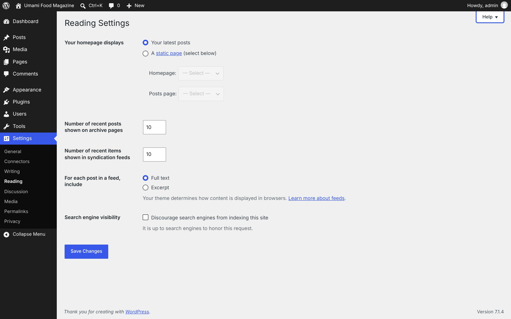
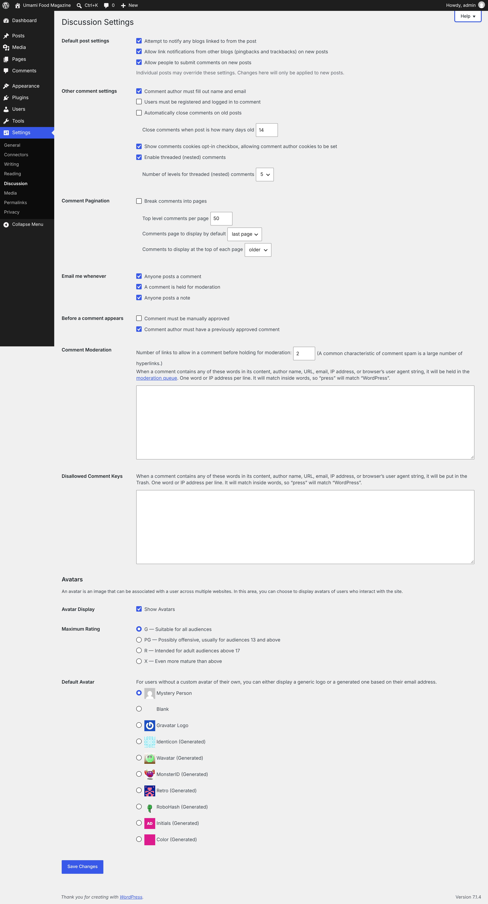
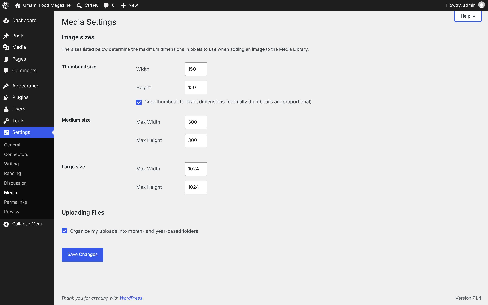
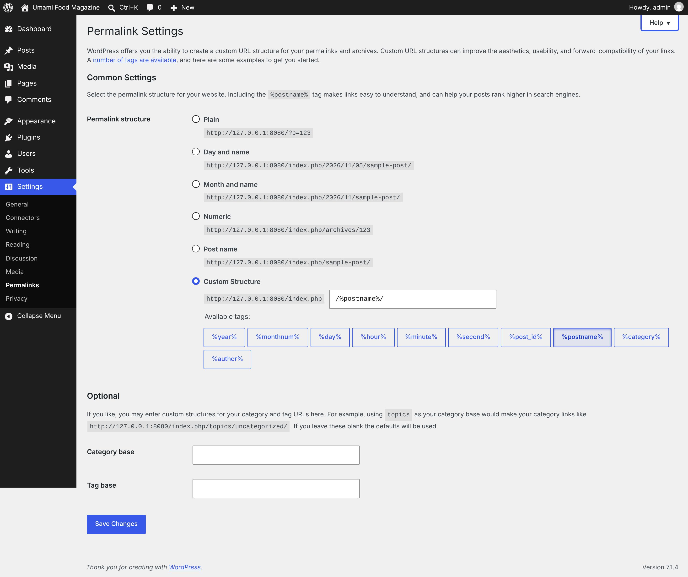
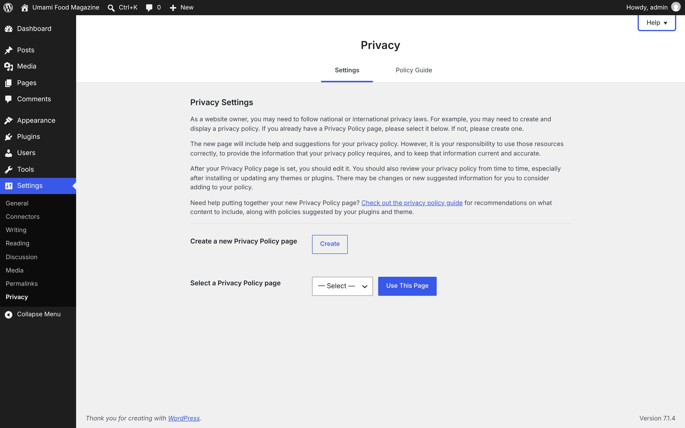

# Settings

[← Overview](00-overview.md)

Top-level menu **Settings** → `options-general.php`

Submenu:
- General → `options-general.php`
- Connectors → `options-connectors.php`
- Writing → `options-writing.php`
- Reading → `options-reading.php`
- Discussion → `options-discussion.php`
- Media → `options-media.php`
- Permalinks → `options-permalink.php`
- Privacy → `options-privacy.php`

Pages in this file:
- [Settings](#settings)
- [Connectors](#connectors)
- [Writing](#writing)
- [Reading](#reading)
- [Discussion](#discussion)
- [Media](#media)
- [Permalinks](#permalinks)
- [Privacy](#privacy)

---

## Settings

- **Menu path:** Settings
- **URL:** `options-general.php`
- **Heading:** General Settings
- **Browser title:** General Settings ‹ Umami Food Magazine — WordPress
- **Primary actions:** Save Changes
- **Help tabs:** Overview



<details><summary>Form fields (22)</summary>

- Site Title
- Tagline
- WordPress Address (URL)
- Site Address (URL)
- Administration Email Address
- Anyone can register
- New User Default Role
- Site Language
- Timezone
- November 5, 2026F j, Y
- 2026-11-05Y-m-d
- 11/05/2026m/d/Y
- 05/11/2026d/m/Y
- 05.11.2026d.m.Y
- Custom: enter a custom date format in the following field
- Custom date format:
- 6:32 amg:i a
- 6:32 AMg:i A
- 06:32H:i
- Custom: enter a custom time format in the following field
- Custom time format:
- Week Starts On

</details>

<details><summary>Page text</summary>

```text
Help
General Settings
Site Title	
Tagline	

In a few words, explain what this site is about. Example: “Just another WordPress site.”

Site Icon	
Choose a Site Icon

The Site Icon is what you see in browser tabs, bookmark bars, and within the WordPress mobile apps. It should be square and at least 512 by 512 pixels.

WordPress Address (URL)	
Site Address (URL)	

Enter the same address here unless you want your site home page to be different from your WordPress installation directory.

Administration Email Address	

This address is used for admin purposes. If you change this, an email will be sent to your new address to confirm it. The new address will not become active until confirmed.

Membership	
Membership
 Anyone can register

New User Default Role	
Subscriber
Contributor
Author

Site Language	
English (United States)
Afrikaans
አማርኛ
Aragonés
العربية
العربية المغربية
অসমীয়া
گؤنئی آذربایجان
Azərbaycan dili
Беларуская мова
Български
বাংলা
བོད་ཡིག
Bosanski
Català
Català (Valencià)
Cebuano
Čeština
Cymraeg
Dansk
Deutsch (Österreich)
Deutsch (Schweiz)
Deutsch (Sie)
Deutsch
Deutsch (Schweiz, Du)
Dolnoserbšćina
རྫོང་ཁ
Ελληνικά
English (Australia)
English (New Zealand)
English (South Africa)
English (Canada)
English (UK)
Esperanto
Español de Argentina
Español de México
Español de Chile
Español de Colombia
Español de Perú
Español de Venezuela
Español de Ecuador
Español de República Dominicana
Español de Uruguay
Español de Puerto Rico
Español de Guatemala
Español
Español de Costa Rica
Eesti
Euskara
فارسی
(فارسی (افغانستان
Suomi
Føroyskt
Français du Canada
Français
Français de Belgique
Friulian
Frysk
Gàidhlig
Galego
ગુજરાતી
هزاره گی
עִבְרִית
हिन्दी
Hrvatski
Hornjoserbšćina
Magyar
Հայերեն
Bahasa Indonesia
Íslenska
Italiano
日本語
Basa Jawa
ქართული
Taqbaylit
Қазақ тілі
ភាសាខ្មែរ
ಕನ್ನಡ
한국어
كوردی‎
Кыргызча
ພາສາລາວ
Lietuvių kalba
Latviešu valoda
Македонски јазик
മലയാളം
Монгол
मराठी
Bahasa Melayu
ဗမာစာ
Norsk bokmål
नेपाली
Nederlands
Nederlands (België)
Nederlands (Formeel)
Norsk nynorsk
Occitan
ਪੰਜਾਬੀ
Nigerian Pidgin
Polski
پښتو
Português
Português (AO90)
Português do Brasil
Português de Angola
Ruáinga
Română
Русский
Сахалыы
سنڌي
සිංහල
Slovenčina
سرائیکی
Slovenščina
Shqip
Српски језик
Svenska
Kiswahili
Ślōnskŏ gŏdka
தமிழ்
தமிழ்
తెలుగు
ไทย
Tagalog
Türkçe
Татар теле
Reo Tahiti
ئۇيغۇرچە
Українська
اردو
O‘zbekcha
Tiếng Việt
Yorùbá
简体中文
繁體中文
香港中文

Timezone	
Abidjan
Accra
Addis Ababa
Algiers
Asmara
Bamako
Bangui
Banjul
Bissau
Blantyre
Brazzaville
Bujumbura
Cairo
Casablanca
Ceuta
Conakry
Dakar
Dar es Salaam
Djibouti
Douala
El Aaiun
Freetown
Gaborone
Harare
Johannesburg
Juba
Kampala
Khartoum
Kigali
Kinshasa
Lagos
Libreville
Lome
Luanda
Lubumbashi
Lusaka
Malabo
Maputo
Maseru
Mbabane
Mogadishu
Monrovia
Nairobi
Ndjamena
Niamey
Nouakchott
Ouagadougou
Porto-Novo
Sao Tome
Tripoli
Tunis
Windhoek
Adak
Anchorage
Anguilla
Antigua
Araguaina
Argentina - Buenos Aires
Argentina - Catamarca
Argentina - Cordoba
Argentina - Jujuy
Argentina - La Rioja
Argentina - Mendoza
Argentina - Rio Gallegos
Argentina - Salta
Argentina - San Juan
Argentina - San Luis
Argentina - Tucuman
Argentina - Ushuaia
Aruba
Asuncion
Atikokan
Bahia
Bahia Banderas
Barbados
Belem
Belize
Blanc-Sablon
Boa Vista
Bogota
Boise
Cambridge Bay
Campo Grande
Cancun
Caracas
Cayenne
Cayman
Chicago
Chihuahua
Ciudad Juarez
Costa Rica
Coyhaique
Creston
Cuiaba
Curacao
Danmarkshavn
Dawson
Dawson Creek
Denver
Detroit
Dominica
Edmonton
Eirunepe
El Salvador
Fortaleza
Fort Nelson
Glace Bay
Goose Bay
Grand Turk
Grenada
Guadeloupe
Guatemala
Guayaquil
Guyana
Halifax
Havana
Hermosillo
Indiana - Indianapolis
Indiana - Knox
Indiana - Marengo
Indiana - Petersburg
Indiana - Tell City
Indiana - Vevay
Indiana - Vincennes
Indiana - Winamac
Inuvik
Iqaluit
Jamaica
Juneau
Kentucky - Louisville
Kentucky - Monticello
Kralendijk
La Paz
Lima
Los Angeles
Lower Princes
Maceio
Managua
Manaus
Marigot
Martinique
Matamoros
Mazatlan
Menominee
Merida
Metlakatla
Mexico City
Miquelon
Moncton
Monterrey
Montevideo
Montserrat
Nassau
New York
Nome
N
```

</details>

<details><summary>Help panel</summary>

**Overview**

The fields on this screen determine some of the basics of your site setup.
Most themes show the site title at the top of every page, in the title bar of the browser, and as the identifying name for syndicated feeds. Many themes also show the tagline.
Two terms you will want to know are the WordPress URL and the site URL. The WordPress URL is where the core WordPress installation files are, and the site URL is the address a visitor uses in the browser to go to your site.
Though the terms refer to two different concepts, in practice, they can be the same address or different. For example, you can have the core WordPress installation files in the root directory (https://example.com), in which case the two URLs would be the same. Or the WordPress files can be in a subdirectory (https://example.com/wordpress). In that case, the WordPress URL and the site URL would be different.
Both WordPress URL and site URL can start with either http:// or https://. A URL starting with https:// requires an SSL certificate, so be sure that you have one before changing to https://. With https://, a padlock will appear next to the address in the browser address bar. Both https:// and the padlock signal that your site meets some basic security requirements, which can build trust with your visitors and with search engines.
If you want site visitors to be able to register themselves, check the membership box. If you want the site administrator to register every new user, leave the box unchecked. In either case, you can set a default user role for all new users.
You can set the language, and WordPress will automatically download and install the translation files (available if your filesystem is writable).
UTC means Coordinated Universal Time.
You must click the Save Changes button at the bottom of the screen for new settings to take effect.

</details>

---

## Connectors

- **Menu path:** Settings → Connectors
- **URL:** `options-connectors.php`
- **Heading:** Connectors
- **Browser title:** Connectors ‹ Umami Food Magazine — WordPress



<details><summary>Page text</summary>

```text
Connectors

All of your API keys and credentials are stored here and shared across plugins. Configure once and use everywhere.

The AI plugin can use your AI connectors to generate featured images, alt text, titles, excerpts and more. Learn more↗

Install the AI plugin
Akismet Anti-spam
Protect your site from spam.
Activate
Anthropic
Text generation with Claude.
Install
Google
Text and image generation with Gemini and Imagen.
Install
OpenAI
Text and image generation with GPT and Dall-E.
Install

If the connector you need is not listed, search the plugin directory to see if a connector is available.
```

</details>

---

## Writing

- **Menu path:** Settings → Writing
- **URL:** `options-writing.php`
- **Heading:** Writing Settings
- **Browser title:** Writing Settings ‹ Umami Food Magazine — WordPress
- **Primary actions:** Save Changes
- **Help tabs:** Overview · Post Via Email · Update Services



<details><summary>Form fields (7)</summary>

- Default Post Category
- Default Post Format
- Mail Server
- Port
- Login Name
- Password
- Default Mail Category

</details>

<details><summary>Page text</summary>

```text
Help
Writing Settings
Default Post Category	
Articles
Recipes
   Accompaniments
   Desserts
   Main courses
   Snacks
   Starters
Uncategorized

Default Post Format	
Standard
Aside
Chat
Gallery
Link
Image
Quote
Status
Video
Audio
Post via email

To post to WordPress by email, you must set up a secret email account with POP3 access. Any mail received at this address will be posted, so it’s a good idea to keep this address very secret. Here are three random strings you could use: R7D2mXdn, RFvPrIsT, oJksjagl.

Mail Server	 Port 
Login Name	
Password	

Default Mail Category	
Articles
Recipes
   Accompaniments
   Desserts
   Main courses
   Snacks
   Starters
Uncategorized
Update Services

When you publish a new post, WordPress automatically notifies the following site update services. For more about this, see the Update Services documentation article. Separate multiple service URLs with line breaks.
```

</details>

<details><summary>Help panel</summary>

**Overview**

You can submit content in several different ways; this screen holds the settings for all of them. The top section controls the editor within the dashboard, while the rest control external publishing methods. For more information on any of these methods, use the documentation links.
You must click the Save Changes button at the bottom of the screen for new settings to take effect.

**Post Via Email**

Post via email settings allow you to send your WordPress installation an email with the content of your post. You must set up a secret email account with POP3 access to use this, and any mail received at this address will be posted, so it’s a good idea to keep this address very secret.

**Update Services**

If desired, WordPress will automatically alert various services of your new posts.

</details>

---

## Reading

- **Menu path:** Settings → Reading
- **URL:** `options-reading.php`
- **Heading:** Reading Settings
- **Browser title:** Reading Settings ‹ Umami Food Magazine — WordPress
- **Primary actions:** Save Changes
- **Help tabs:** Overview · Search engine visibility



<details><summary>Form fields (9)</summary>

- Your latest posts
- A static page (select below)
- Homepage: — Select — About Umami
- Posts page: — Select — About Umami
- Number of recent posts shown on archive pages
- Number of recent items shown in syndication feeds
- Full text
- Excerpt
- Discourage search engines from indexing this site

</details>

<details><summary>Page text</summary>

```text
Help
Reading Settings
Your homepage displays	
Your homepage displays

 Your latest posts

 A static page (select below)

Homepage: 
— Select —
About Umami
Posts page: 
— Select —
About Umami

Number of recent posts shown on archive pages	
Number of recent items shown in syndication feeds	
For each post in a feed, include	
For each post in a feed, include

 Full text
 Excerpt

Your theme determines how content is displayed in browsers. Learn more about feeds.

Search engine visibility	
Search engine visibility
 Discourage search engines from indexing this site

It is up to search engines to honor this request.
```

</details>

<details><summary>Help panel</summary>

**Overview**

This screen contains the settings that affect the display of your content.
You can choose what’s displayed on the homepage of your site. It can be posts in reverse chronological order (classic blog), or a fixed/static page. To set a static homepage, you first need to create two Pages. One will become the homepage, and the other will be where your posts are displayed.
You can also control the display of your content in RSS feeds, including the maximum number of posts to display and whether to show full text or an excerpt. Learn more about feeds.
You must click the Save Changes button at the bottom of the screen for new settings to take effect.

**Search engine visibility**

You can choose whether or not your site will be crawled by robots, ping services, and spiders. If you want those services to ignore your site, click the checkbox next to “Discourage search engines from indexing this site” and click the Save Changes button at the bottom of the screen.Note that even when set to discourage search engines, your site is still visible on the web and not all search engines adhere to this directive.When this setting is in effect, a reminder is shown in the At a Glance box of the Dashboard that says, “Search engines discouraged”, to remind you that you have directed search engines to not crawl your site.

</details>

---

## Discussion

- **Menu path:** Settings → Discussion
- **URL:** `options-discussion.php`
- **Heading:** Discussion Settings
- **Browser title:** Discussion Settings ‹ Umami Food Magazine — WordPress
- **Primary actions:** Save Changes
- **Help tabs:** Overview



<details><summary>Form fields (33)</summary>

- Attempt to notify any blogs linked to from the post
- Allow people to submit comments on new posts
- Comment author must fill out name and email
- Users must be registered and logged in to comment
- Automatically close comments on old posts
- Close comments when post is how many days old
- Enable threaded (nested) comments
- Number of levels for threaded (nested) comments
- Break comments into pages
- Top level comments per page
- Comments page to display by default
- Comments to display at the top of each page
- Anyone posts a comment
- A comment is held for moderation
- Anyone posts a note
- Comment must be manually approved
- Comment author must have a previously approved comment
- Number of links to allow in a comment before holding for moderation:
- Show Avatars
- G — Suitable for all audiences
- PG — Possibly offensive, usually for audiences 13 and above
- R — Intended for adult audiences above 17
- X — Even more mature than above
- Mystery Person
- Blank
- Gravatar Logo
- Identicon (Generated)
- Wavatar (Generated)
- MonsterID (Generated)
- Retro (Generated)
- RoboHash (Generated)
- Initials (Generated)
- Color (Generated)

</details>

<details><summary>Page text</summary>

```text
Help
Discussion Settings
Default post settings	
Default post settings
 Attempt to notify any blogs linked to from the post
 Allow link notifications from other blogs (pingbacks and trackbacks) on new posts
 Allow people to submit comments on new posts

Individual posts may override these settings. Changes here will only be applied to new posts.

Other comment settings	
Other comment settings
 Comment author must fill out name and email
 Users must be registered and logged in to comment
 Automatically close comments on old posts
Close comments when post is how many days old 
 Show comments cookies opt-in checkbox, allowing comment author cookies to be set
 Enable threaded (nested) comments
Number of levels for threaded (nested) comments 
2
3
4
5
6
7
8
9
10

Comment Pagination	
Comment Pagination
 Break comments into pages
Top level comments per page 
Comments page to display by default 
last page
first page
Comments to display at the top of each page 
older
newer

Email me whenever	
Email me whenever
 Anyone posts a comment
 A comment is held for moderation
 Anyone posts a note

Before a comment appears	
Before a comment appears
 Comment must be manually approved
 Comment author must have a previously approved comment

Comment Moderation	
Comment Moderation

Number of links to allow in a comment before holding for moderation:  (A common characteristic of comment spam is a large number of hyperlinks.)

When a comment contains any of these words in its content, author name, URL, email, IP address, or browser’s user agent string, it will be held in the moderation queue. One word or IP address per line. It will match inside words, so “press” will match “WordPress”.

Disallowed Comment Keys	
Disallowed Comment Keys

When a comment contains any of these words in its content, author name, URL, email, IP address, or browser’s user agent string, it will be put in the Trash. One word or IP address per line. It will match inside words, so “press” will match “WordPress”.

Avatars

An avatar is an image that can be associated with a user across multiple websites. In this area, you can choose to display avatars of users who interact with the site.

Avatar Display	 Show Avatars
Maximum Rating	
Maximum Rating
 G — Suitable for all audiences
 PG — Possibly offensive, usually for audiences 13 and above
 R — Intended for adult audiences above 17
 X — Even more mature than above

Default Avatar	
Default Avatar

For users without a custom avatar of their own, you can either display a generic logo or a generated one based on their email address.

  Mystery Person
  Blank
  Gravatar Logo
  Identicon (Generated)
  Wavatar (Generated)
  MonsterID (Generated)
  Retro (Generated)
  RoboHash (Generated)
  Initials (Generated)
  Color (Generated)
```

</details>

<details><summary>Help panel</summary>

**Overview**

This screen provides many options for controlling the management and display of comments and links to your posts/pages. So many, in fact, they will not all fit here! :) Use the documentation links to get information on what each discussion setting does.
You must click the Save Changes button at the bottom of the screen for new settings to take effect.

</details>

---

## Media

- **Menu path:** Settings → Media
- **URL:** `options-media.php`
- **Heading:** Media Settings
- **Browser title:** Media Settings ‹ Umami Food Magazine — WordPress
- **Primary actions:** Save Changes
- **Help tabs:** Overview



<details><summary>Form fields (6)</summary>

- Width
- Height
- Crop thumbnail to exact dimensions (normally thumbnails are proportional)
- Max Width
- Max Height
- Organize my uploads into month- and year-based folders

</details>

<details><summary>Page text</summary>

```text
Help
Media Settings
Image sizes

The sizes listed below determine the maximum dimensions in pixels to use when adding an image to the Media Library.

Thumbnail size	
Thumbnail size
Width 
Height 
 Crop thumbnail to exact dimensions (normally thumbnails are proportional)
Medium size	
Medium size
Max Width 
Max Height 

Large size	
Large size
Max Width 
Max Height 
Uploading Files
 Organize my uploads into month- and year-based folders
```

</details>

<details><summary>Help panel</summary>

**Overview**

You can set maximum sizes for images inserted into your written content; you can also insert an image as Full Size.
You must click the Save Changes button at the bottom of the screen for new settings to take effect.

</details>

---

## Permalinks

- **Menu path:** Settings → Permalinks
- **URL:** `options-permalink.php`
- **Heading:** Permalink Settings
- **Browser title:** Permalink Settings ‹ Umami Food Magazine — WordPress
- **Primary actions:** Save Changes
- **Help tabs:** Overview · Permalink Settings · Custom Structures



<details><summary>Form fields (9)</summary>

- Plain
- Day and name
- Month and name
- Numeric
- Post name
- Custom Structure
- Customize permalink structure by selecting available tags
- Category base
- Tag base

</details>

<details><summary>Page text</summary>

```text
Help
Permalink Settings

WordPress offers you the ability to create a custom URL structure for your permalinks and archives. Custom URL structures can improve the aesthetics, usability, and forward-compatibility of your links. A number of tags are available, and here are some examples to get you started.

Common Settings

Select the permalink structure for your website. Including the %postname% tag makes links easy to understand, and can help your posts rank higher in search engines.

Permalink structure	
Permalink structure
 
Plain

http://127.0.0.1:8080/?p=123

 
Day and name

http://127.0.0.1:8080/index.php/2026/11/05/sample-post/

 
Month and name

http://127.0.0.1:8080/index.php/2026/11/sample-post/

 
Numeric

http://127.0.0.1:8080/index.php/archives/123

 
Post name

http://127.0.0.1:8080/index.php/sample-post/

 
Custom Structure

Customize permalink structure by selecting available tags
http://127.0.0.1:8080/index.php 

Available tags:
%year%
%monthnum%
%day%
%hour%
%minute%
%second%
%post_id%
%postname%
%category%
%author%
Optional

If you like, you may enter custom structures for your category and tag URLs here. For example, using topics as your category base would make your category links like http://127.0.0.1:8080/index.php/topics/uncategorized/. If you leave these blank the defaults will be used.

Category base	
Tag base
```

</details>

<details><summary>Help panel</summary>

**Overview**

Permalinks are the permanent URLs to your individual pages and blog posts, as well as your category and tag archives. A permalink is the web address used to link to your content. The URL to each post should be permanent, and never change — hence the name permalink.
This screen allows you to choose your permalink structure. You can choose from common settings or create custom URL structures.
You must click the Save Changes button at the bottom of the screen for new settings to take effect.

**Permalink Settings**

Permalinks can contain useful information, such as the post date, title, or other elements. You can choose from any of the suggested permalink formats, or you can craft your own if you select Custom Structure.If you pick an option other than Plain, your general URL path with structure tags (terms surrounded by %) will also appear in the custom structure field and your path can be further modified there.When you assign multiple categories or tags to a post, only one can show up in the permalink: the lowest numbered category. This applies if your custom structure includes %category% or %tag%.You must click the Save Changes button at the bottom of the screen for new settings to take effect.

**Custom Structures**

The Optional fields let you customize the “category” and “tag” base names that will appear in archive URLs. For example, the page listing all posts in the “Uncategorized” category could be /topics/uncategorized instead of /category/uncategorized.You must click the Save Changes button at the bottom of the screen for new settings to take effect.

</details>

---

## Privacy

- **Menu path:** Settings → Privacy
- **URL:** `options-privacy.php`
- **Heading:** Privacy
- **Browser title:** Privacy ‹ Umami Food Magazine — WordPress
- **Primary actions:** Create · Use This Page
- **Help tabs:** Overview



<details><summary>Page text</summary>

```text
Help
Privacy
Settings
Policy Guide
Privacy Settings

As a website owner, you may need to follow national or international privacy laws. For example, you may need to create and display a privacy policy. If you already have a Privacy Policy page, please select it below. If not, please create one.

The new page will include help and suggestions for your privacy policy. However, it is your responsibility to use those resources correctly, to provide the information that your privacy policy requires, and to keep that information current and accurate.

After your Privacy Policy page is set, you should edit it. You should also review your privacy policy from time to time, especially after installing or updating any themes or plugins. There may be changes or new suggested information for you to consider adding to your policy.

Need help putting together your new Privacy Policy page? Check out the privacy policy guide for recommendations on what content to include, along with policies suggested by your plugins and theme.

Create a new Privacy Policy page	

Select a Privacy Policy page	
— Select —
About Umami
```

</details>

<details><summary>Help panel</summary>

**Overview**

The Privacy screen lets you either build a new privacy-policy page or choose one you already have to show.
This screen includes suggestions to help you write your own privacy policy. However, it is your responsibility to use these resources correctly, to provide the information required by your privacy policy, and to keep this information current and accurate.

</details>
